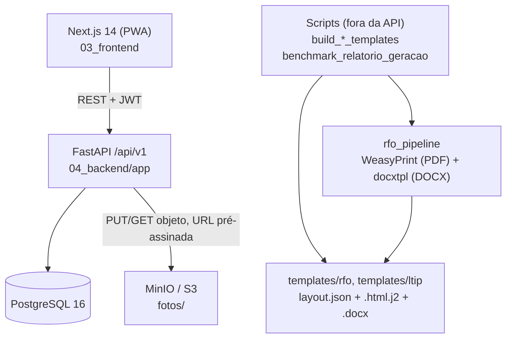
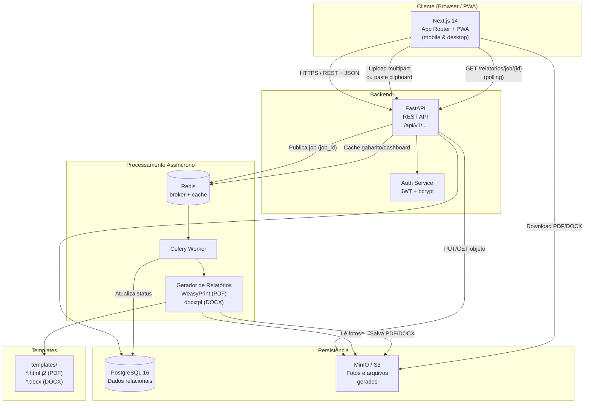
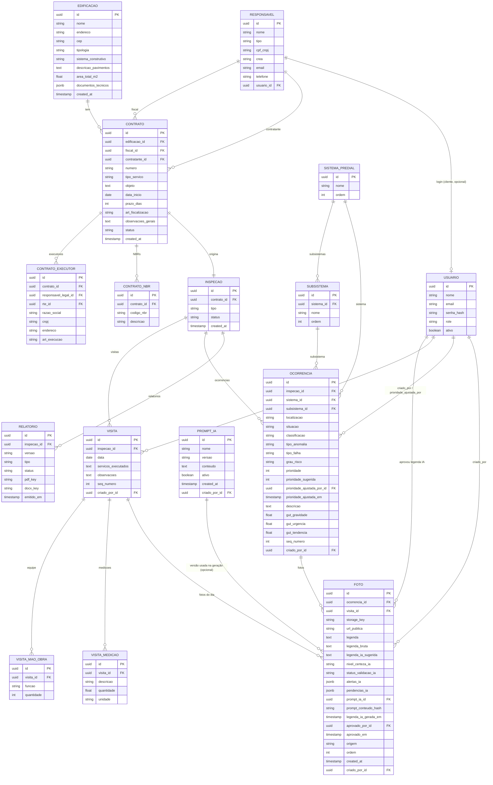
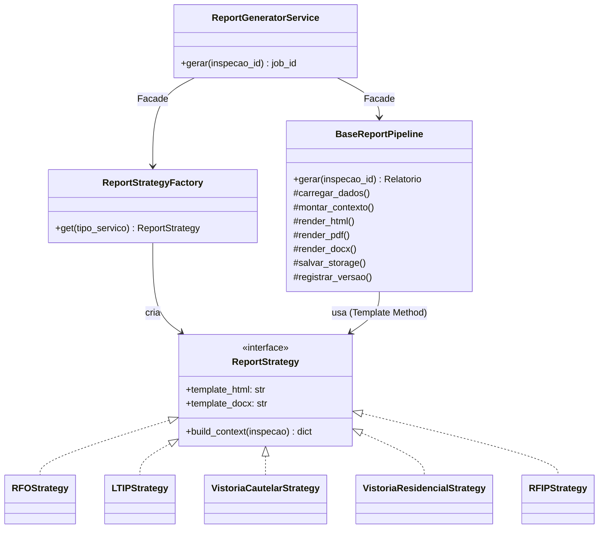
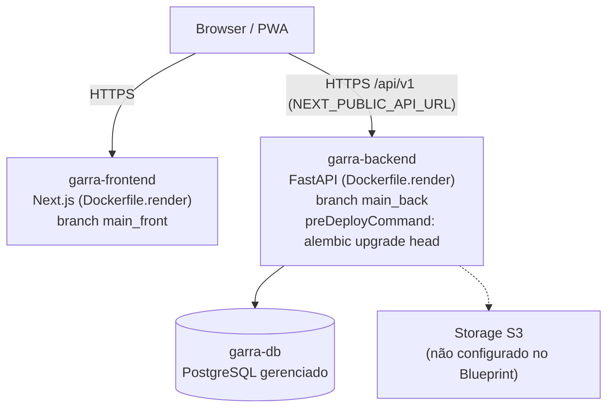
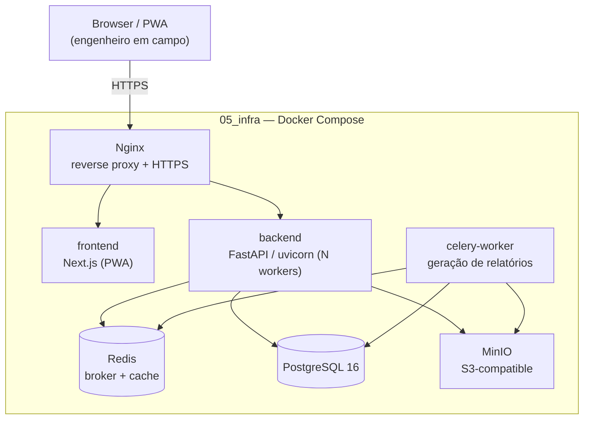
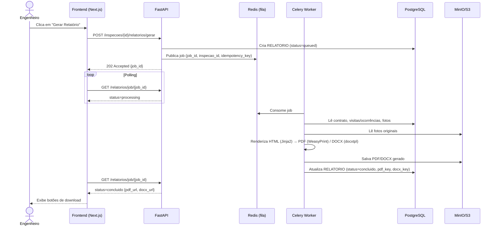
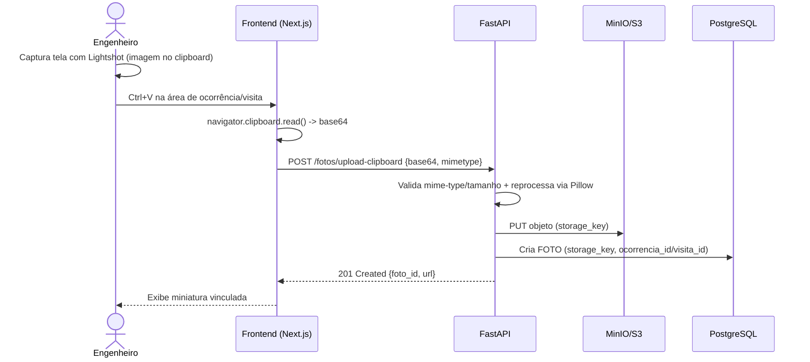
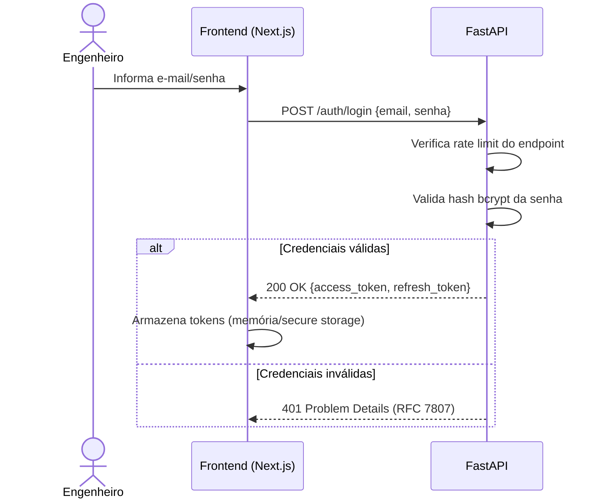

---
title: Arquitetura de Software — Sistema de Automação de Relatórios Prediais
type: knowledge
status: ativo
owner: Garra Engenharia
related:
  - 00_docs/estudo-do-contexto.md
  - 00_docs/convertidos/RFO_INSPECAO.md
  - 00_docs/projeto/decisoes.md
  - 00_docs/dicionario-de-dados.md
tags: [arquitetura, stack, modelo-de-dados, api, pdf, lightshot, padroes-de-projeto, system-design, seguranca, rbac, portal-cliente, mcp, notion, ia-legendas]
last_updated: 2026-11-03
---

<!-- ai-summary
System: blueprint técnico do sistema de automação de relatórios prediais da Garra Engenharia, com o estado real da implementação na Seção 0.
Flow implementado: Next.js (PWA) -> FastAPI -> PostgreSQL + MinIO; templates RFO/LTIP derivados por script; PDF/DOCX do RFO só por script (sem rota na API).
Flow-alvo: ... -> fila Redis/Celery -> gerador de PDF/DOCX (WeasyPrint + docxtpl) exposto por API.
Owner: Eng. Civil Esp. Roniel Ribeiro Costa.
Systems: Next.js, FastAPI, PostgreSQL, MinIO, WeasyPrint, docxtpl, Lightshot; Redis e Celery previstos (ADR-06), não implantados.
Deploy real: Render (garra-backend, garra-frontend, garra-db, render.yaml); VPS com Nginx como alternativa.
Status: ativo (verificado na D05, 2026-11-04) — Seção 0 adicionada em 2026-11-03 (D04) separando implementado de planejado. Lacunas de maior impacto fechadas em 2026-09-10 (ADR-14/ADR-15). Seções 9-11 de 2026-07-17.
-->

# Arquitetura de Software — Sistema de Automação de Relatórios Prediais

## 0. Estado da implementação (2026-11-03)

Este documento mistura a arquitetura implementada e a arquitetura-alvo. A tabela abaixo diz o que existe no código; as seções seguintes marcam como **planejado** o que ainda não existe. A referência coluna a coluna do banco está em [dicionario-de-dados.md](dicionario-de-dados.md).

| Componente | Estado | Evidência |
|---|---|---|
| Frontend Next.js 14 (App Router), instalável como PWA | **Implementado**, sem service worker (online-first, ADR-15) | `03_frontend/app/layout.tsx` (`manifest`), `03_frontend/public/manifest.json` |
| API REST FastAPI, 11 routers em `/api/v1` | **Implementado** | `04_backend/app/main.py` (11 `include_router`), `app/api/v1/*.py` |
| JWT + bcrypt; RBAC `auditor`/`auxiliar`/`cliente` | **Implementado** | `app/core/security.py`, `app/api/deps.py` (`require_auditor`, `require_equipe`, `get_current_cliente_responsavel`) |
| PostgreSQL 16 + Alembic | **Implementado**: 18 tabelas, 6 migrations | `app/models/`, `alembic/versions/` |
| Storage MinIO/S3 (fotos, URLs pré-assinadas de 15 min) | **Implementado** no compose local. No `render.yaml` as variáveis `MINIO_*` estão comentadas | `app/services/storage/s3_client.py`, `app/services/foto_service.py`, `render.yaml` |
| Upload de foto (multipart e clipboard) e anotação com Fabric.js | **Implementado** | `app/api/v1/fotos.py`, `03_frontend/components/photo-annotation-editor.tsx` |
| Dashboard da edificação e portal do cliente | **Implementado**. A lista de relatórios do portal fica vazia porque nenhuma rota cria `relatorios` | `app/api/v1/dashboard.py`, `app/api/v1/portal.py`, `app/services/portal_service.py` |
| RN-04: prioridade sugerida pelo grau de risco, com registro da sobrescrita | **Implementado** | `app/services/ocorrencia_service.py:12-133`, migration `d3b7c9e4f1a2` |
| Templates RFO e LTIP derivados dos originais (`layout.json` → `.html.j2` + `.docx`) | **Implementado** (scripts) | `templates/rfo/`, `templates/ltip/`, `app/scripts/build_rfo_templates.py`, `build_ltip_templates.py` (ADR-13) |
| Pipeline de renderização do RFO (`gerar_pdf`, `gerar_docx`) | **Implementado**, mas só chamado por script | `app/services/report_generator/rfo_pipeline.py`; chamado por `app/scripts/benchmark_relatorio_geracao.py` |
| Rotas de geração e download de relatório (`/inspecoes/{id}/relatorios/gerar`, `/relatorios/job/{id}`) | **Planejado** | nenhuma rota em `app/api/v1/`; tela `03_frontend/app/inspecoes/[id]/relatorio/page.tsx` usa `UnderConstruction` |
| Pipeline do LTIP; templates de RFIP e vistorias | **Planejado** | `report_generator/` só tem `rfo_pipeline.py` |
| Strategy/Factory de relatórios (`report_generator/strategies/`) | **Planejado** (Seção 9) | `ls 04_backend/app/services/report_generator` |
| Fila Celery + Redis (ADR-06) e cache Redis (Seção 10.4) | **Planejado** | ausentes de `requirements.txt` e de `05_infra/docker-compose.yml` (comentário na linha 32) |
| Legendas por IA (ADR-12, RF-15), tabela `prompts_ia` | **Parcial**: modelo de dados implementado (BL-36, migration `f7c2a9d4e6b1`); adapter, endpoint de geração e provedor planejados (B-04) | `04_backend/app/models/prompt_ia.py`, `app/models/foto.py`; sem SDK de LLM em `requirements.txt` |
| Observabilidade | **Parcial**: `GET /health` (com estado do banco) e `X-Request-ID`; não há `GET /health/ready` nem log em JSON | `app/main.py:32` (`logging.basicConfig`), `:85`; `app/core/middleware.py` |
| Produção | **Render**: `garra-backend` (branch `main_back`), `garra-frontend` (`main_front`), `garra-db` | `render.yaml` |
| VPS com Nginx (alternativa) | **Implementado como alternativa**, sem uso em produção | `05_infra/docker-compose.prod.yml`, `05_infra/nginx/nginx.conf`, `.github/workflows/cd-*.yml` |

## 1. Stack Tecnológica

### Escolhas e justificativas

| Camada | Tecnologia | Justificativa |
|---|---|---|
| **Frontend** | Next.js 14 (App Router) como PWA | Funciona como site e app instalável no celular sem loja de app; renderização híbrida; excelente ecossistema de formulários e tabelas. |
| **Estilo / UI** | Tailwind CSS + shadcn/ui | Componentes acessíveis prontos (formulários, tabelas, modais); produtividade alta para interface de dados. |
| **Backend** | FastAPI (Python 3.12) | Mesmo ecossistema das bibliotecas de geração de PDF/DOCX (WeasyPrint, docxtpl, Jinja2, Pillow); async nativo; tipagem com Pydantic; documentação OpenAPI automática. |
| **Banco de dados** | PostgreSQL 16 | Modelo relacional forte para as entidades complexas (Ocorrência → Foto → Sistema → Subsistema); suporte a JSONB para campos flexíveis; transações ACID. |
| **ORM** | SQLAlchemy 2 + Alembic | ORM maduro com suporte async; migrations versionadas. |
| **Armazenamento de arquivos** | MinIO (auto-hospedado) ou AWS S3 | Fotos de inspeção podem chegar a GB por contrato; separar arquivos binários do banco é mandatório (RNF-07). API S3-compatível permite migrar entre provedores. |
| **Geração de PDF** | WeasyPrint + Jinja2 (HTML→PDF) | Permite construir templates HTML/CSS fiéis ao layout atual; suporte a imagens, tabelas complexas e paginação personalizada. Melhor controle de layout que ReportLab para documentos de alta fidelidade visual. |
| **Geração de DOCX** | docxtpl (python-docx + Jinja2) | Usa um arquivo .docx como template com tags `{{ variavel }}`; preserva a formatação exata do documento original. |
| **Autenticação** | FastAPI + JWT (python-jose) + bcrypt | Simples e seguro para uso individual/pequena equipe; sem dependência de serviço externo. |
| **Autorização (RBAC)** | Papéis `auditor` / `auxiliar` / `cliente` em `Usuario.role` + dependency `require_role()` no FastAPI | Três perfis de acesso: auditor (engenheiro responsável técnico, acesso total de escrita e emissão), auxiliar (escrita apenas de dados de campo — visitas, ocorrências e fotos — sem emitir relatório nem cadastrar usuários, ver ADR-14/DEC-27) e cliente (contratante/síndico, somente leitura e escopado às próprias Edificações/Contratos via Portal do Cliente — ver DEC-18, RF-13). |
| **Anotação de Imagens** | Fabric.js (canvas client-side) no frontend | Permite ao auditor desenhar setas, formas, texto e traço livre diretamente sobre a foto no browser antes de salvar — reproduz dentro do sistema a função de marcação hoje feita externamente no Lightshot (ver DEC-19, RF-14). Não exige nenhum endpoint novo de backend: a imagem já achatada (canvas → blob) é enviada aos endpoints de upload existentes (BL-11). |
| **Geração de Legendas por IA** | LLM externo via Adapter `LegendaIAClient` — provedor a definir | Transforma anotação de campo/transcrição de áudio fornecida pelo auditor em legenda técnica estruturada, usando um prompt-sistema versionado (tabela `prompts_ia`) fornecido pelo cliente. Sempre gera uma minuta editável — nunca substitui a legenda automaticamente — sujeita a aprovação do profissional habilitado (ver ADR-12, RF-15, RN-16, RN-17). |
| **Fila / Cache** (planejado) | Redis 7 | Broker de tarefas assíncronas (Celery) e cache de curto prazo para gabarito de sistemas prediais e agregados do dashboard (ver ADR-06 e Seção 10.4). |
| **Processamento assíncrono** (planejado) | Celery (worker dedicado) | Geração de PDF/DOCX de até 200 páginas roda fora do ciclo de requisição HTTP, cumprindo RNF-06 sem bloquear a API (ver ADR-06). |
| **Integração Lightshot** | Upload via clipboard paste (browser API) + upload manual | Ver seção 6. |
| **Deploy** | Docker Compose (local) ou Render (nuvem) | Hospedagem definida como Render em 2026-07-21 (B-03 resolvido). |

---

## 2. Diagrama de Arquitetura

### 2.1 Como está implementado (2026-11-03)



Não há fila, worker nem rota de geração: o pipeline do RFO só é chamado por script (Seção 0).

### 2.2 Arquitetura-alvo

Redis, Celery e as rotas `/relatorios` abaixo são **planejados** (ADR-06).



---

## 3. Modelo de Dados (Diagrama ER)

> Referência coluna a coluna, com tipos, nulabilidade e regras: [dicionario-de-dados.md](dicionario-de-dados.md). A entidade `PROMPT_IA` e os campos de legenda IA de `FOTO` existem desde a migration `f7c2a9d4e6b1` (BL-36, DEC-37); o adapter `LegendaIAClient` e o endpoint de geração continuam planejados (ADR-12, B-04). As tabelas de gabarito `tipos_anomalia`, `tipos_falha` e `localizacoes` existem (migration `8e2467ad6a92`) e não aparecem no diagrama.



---

## 4. Contratos de API

Base URL: `/api/v1`. Fonte das rotas implementadas: `grep -nE '@router\.(get|post|put|patch|delete)\(' 04_backend/app/api/v1/*.py`. Rotas marcadas **(planejado)** não existem no código. Fora de `/api/v1` existe `GET /health` (`app/main.py`).

### Autenticação

| Método | Endpoint | Descrição |
|---|---|---|
| `POST` | `/auth/register` | Cria usuário. Exige auditor autenticado, exceto enquanto não houver nenhum usuário (bootstrap, DEC-24; `app/api/v1/auth.py:38-43`) |
| `POST` | `/auth/login` | Retorna o token JWT (com rate limit, `app/core/rate_limit.py`) |
| `GET` | `/auth/me` | Dados do usuário autenticado |

### Edificações

| Método | Endpoint | Descrição |
|---|---|---|
| `GET` | `/edificacoes` | Lista edificações (paginado, filtro por nome/endereço) |
| `POST` | `/edificacoes` | Cria edificação |
| `GET` | `/edificacoes/{id}` | Detalhe da edificação com histórico de contratos |
| `PUT` | `/edificacoes/{id}` | Atualiza edificação |
| `POST` | `/edificacoes/{id}/documentos` | Envia um documento técnico (projeto, ART) e o anexa a `documentos_tecnicos` (DEC-16; `edificacoes.py:80`) |
| `GET` | `/edificacoes/{id}/dashboard` | Indicadores de saúde por sistema predial (`app/api/v1/dashboard.py`) |

### Contratos

| Método | Endpoint | Descrição |
|---|---|---|
| `GET` | `/contratos` | Lista contratos (filtro por tipo, status, edificação) |
| `POST` | `/contratos` | Cria contrato com empresas executoras e NBRs |
| `GET` | `/contratos/{id}` | Detalhe completo do contrato |
| `PUT` | `/contratos/{id}` | Atualiza contrato |

### Responsáveis (fiscal, responsável legal, RTE, contratante — DEC-23)

| Método | Endpoint | Descrição |
|---|---|---|
| `GET` | `/responsaveis` | Lista responsáveis, filtro opcional por `tipo` (sem paginação) |
| `POST` | `/responsaveis` | Cria um Responsável, referenciado por `fiscal_id`/`responsavel_legal_id`/`rte_id`/`contratante_id` de Contrato |
| `GET` | `/responsaveis/{id}` | Detalhe de um Responsável |

### Inspeções e Visitas

| Método | Endpoint | Descrição |
|---|---|---|
| `GET` | `/inspecoes/{id}` | Detalhe da inspeção com visitas e ocorrências |
| `POST` | `/inspecoes/{id}/visitas` | Cria visita de fiscalização |
| `PUT` | `/visitas/{id}` | Atualiza visita (equipe, serviços, medições) |
| `POST` | `/visitas/{id}/mao-obra` | Adiciona registro de mão de obra |
| `POST` | `/visitas/{id}/medicoes` | Adiciona medição |

### Ocorrências

| Método | Endpoint | Descrição |
|---|---|---|
| `GET` | `/inspecoes/{id}/ocorrencias` | Lista ocorrências da inspeção (filtro por sistema, grau de risco) |
| `POST` | `/inspecoes/{id}/ocorrencias` | Cria ocorrência com classificação completa |
| `GET` | `/ocorrencias/{id}` | Detalhe de uma ocorrência (`ocorrencias.py:58`) |
| `PUT` | `/ocorrencias/{id}` | Atualiza ocorrência |
| `DELETE` | `/ocorrencias/{id}` | Remove ocorrência |

### Fotos

| Método | Endpoint | Descrição |
|---|---|---|
| `POST` | `/fotos/upload` | Upload de arquivo (multipart/form-data) — retorna `storage_key` e URL |
| `POST` | `/fotos/upload-clipboard` | Recebe imagem em base64 do clipboard paste — retorna `storage_key` e URL |
| `POST` | `/ocorrencias/{id}/fotos` | Vincula foto a ocorrência com legenda |
| `POST` | `/visitas/{id}/fotos` | Vincula foto a visita de fiscalização |
| `POST` | `/fotos/{id}/legenda-ia/gerar` **(planejado)** | Envia descrição bruta/transcrição + dados da ocorrência ao provedor de IA (prompt-sistema versionado); retorna legenda sugerida estruturada, sem persistir como definitiva (ADR-12, RF-15) |
| `PUT` | `/fotos/{id}` | Atualiza legenda ou ordem. A gravação de `aprovado_por_id`/`aprovado_em`/`prompt_ia_id` na aprovação da sugestão de IA é **planejada** (os campos não existem) |
| `DELETE` | `/fotos/{id}` | Remove vínculo e objeto do storage |

### Relatórios **(planejado)**

Nenhuma das rotas abaixo existe no código (Seção 0). O download para o cliente já existe no portal (`/portal/relatorios/{id}/download/{formato}`), mas depende de registros em `relatorios` que hoje só o script de benchmark cria.

| Método | Endpoint | Descrição |
|---|---|---|
| `POST` | `/inspecoes/{id}/relatorios/gerar` | Dispara geração assíncrona de PDF e DOCX (retorna `job_id`) |
| `GET` | `/relatorios/job/{job_id}` | Consulta status do job de geração |
| `GET` | `/relatorios/{id}/download/pdf` | Download do PDF gerado |
| `GET` | `/relatorios/{id}/download/docx` | Download do DOCX gerado |
| `GET` | `/inspecoes/{id}/relatorios` | Histórico de versões emitidas |

### Dados Mestre

| Método | Endpoint | Descrição |
|---|---|---|
| `GET` | `/sistemas-prediais` | Lista sistemas com subsistemas |
| `GET` | `/gabarito/tipos-anomalia` | Lista tipos de anomalia |
| `GET` | `/gabarito/tipos-falha` | Lista tipos de falha |
| `GET` | `/gabarito/localizacoes` | Lista localizações padrão |
| `GET` | `/gabarito/funcoes-mao-obra` **(planejado)** | Lista funções de mão de obra (não há tabela; `visita_mao_obras.funcao` é texto livre) |

### Portal do Cliente (somente leitura, RBAC — DEC-18)

Todos os endpoints abaixo exigem `role=cliente` (via `require_role("cliente")`) e são implicitamente escopados ao `Responsavel` vinculado ao `Usuario` autenticado (`Responsavel.usuario_id = current_user.id`) — nunca aceitam um `edificacao_id`/`contrato_id` arbitrário fora desse escopo (RN-14).

| Método | Endpoint | Descrição |
|---|---|---|
| `GET` | `/portal/edificacoes` | Lista as Edificações em que o cliente autenticado é contratante |
| `GET` | `/portal/edificacoes/{id}/dashboard` | Reaproveita a agregação de `/edificacoes/{id}/dashboard` (RF-07), validando antes que a edificação pertence ao escopo do cliente |
| `GET` | `/portal/edificacoes/{id}/acompanhamento` | Linha do tempo de visitas/ocorrências da inspeção em andamento (status, datas, contagem por grau de risco) — acompanhamento da auditoria em tempo real |
| `GET` | `/portal/relatorios` | Lista os relatórios/laudos já emitidos (RF-11) das Edificações/Contratos do cliente |
| `GET` | `/portal/relatorios/{id}/download/{formato}` | Retorna a URL pré-assinada do PDF ou do DOCX (`formato` = `pdf` ou `docx`), validando o escopo antes de delegar ao storage (`portal.py:80-84`) |

---

## 5. Estratégia de Geração de Relatório

### Princípio

O sistema usa **two-pass rendering**: primeiro gera um DOCX editável (para o engenheiro revisar e ajustar manualmente se necessário) e depois gera o PDF final — ou gera o PDF diretamente se o engenheiro optar por não revisar.

### Pipeline PDF (via WeasyPrint)

```
1. FastAPI recebe requisição POST /inspecoes/{id}/relatorios/gerar
2. Worker Celery (ver ADR-06) consulta banco: contrato, edificação,
   visitas/ocorrências com fotos, responsáveis
3. Jinja2 renderiza template HTML (.html.j2) com os dados
4. WeasyPrint converte HTML+CSS → PDF com:
   - Cabeçalho/rodapé em cada página (logo + dados do engenheiro + nº página)
   - Tabelas de ocorrências paginadas automaticamente
   - Fotos redimensionadas e organizadas por sistema predial
   - Sumário com âncoras automáticas
5. PDF salvo no MinIO; URL retornada ao frontend
```

### Pipeline DOCX (via docxtpl)

```
1. Mesmos dados do passo 2 acima
2. docxtpl abre o arquivo template .docx base (fiel ao modelo atual do cliente)
3. Substituição de tags {{ variavel }} e 
4. DOCX resultante salvo no MinIO; disponível para download e edição
```

### Templates

> **Estado em 2026-11-03:** a lista abaixo é a planejada. No código existem `templates/rfo/` e `templates/ltip/` (cada um com `layout.json`, `<tipo>_template.html.j2` e `<tipo>_template.docx`, gerados por script, ADR-13), `templates/contracts/`, `templates/assets/` (marca, DEC-30) e, soltos na raiz, `rfo_template.html.j2` (sem referência no código) e `rfo_benchmark_template.docx` (do benchmark BL-22). Não há templates de vistoria nem de RFIP. Ver Seção 7.

Os templates são arquivos versionados no repositório em `04_backend/templates/`:
- `rfo_template.html.j2` — Relatório de Fiscalização
- `ltip_template.html.j2` — Laudo de Inspeção Predial
- `vistoria_cautelar_template.html.j2` — Vistoria Cautelar
- `rfip_template.html.j2` — Relatório Fotográfico
- `rfo_template.docx` — equivalentes DOCX

---

## 6. Estratégia de Integração com Lightshot

O Lightshot não expõe API pública. As opções identificadas, em ordem de preferência:

### Opção A — Paste from Clipboard (Recomendada)

O engenheiro captura a tela com Lightshot, a imagem vai para o clipboard. Na interface web do sistema, ele clica em "Colar imagem" ou faz `Ctrl+V` em uma área de drop designada. O browser lê `navigator.clipboard.read()` e envia a imagem em base64 para o endpoint `POST /fotos/upload-clipboard`.

**Prós:** sem instalação adicional; funciona no fluxo atual do Lightshot.  
**Contras:** requer HTTPS (obrigatório para Clipboard API); usuário precisa estar na aba do sistema na hora do paste.

### Opção B — Upload Manual de Arquivo

O Lightshot tem opção de salvar como arquivo local. O engenheiro salva e depois faz upload via input de arquivo padrão. Interface suporta drag-and-drop e seleção múltipla.

**Prós:** funciona em qualquer contexto; mais simples de implementar.  
**Contras:** adiciona um passo manual (salvar + fazer upload).

### Opção C — Pasta Monitorada — ❌ descartada (2026-09-17, DEC-29)

Um cliente desktop leve poderia monitorar uma pasta local e fazer upload automático. **Descartada:** a lacuna #4 foi fechada com a opção (b) — as fotos entram por clipboard/upload manual e a marcação técnica é feita no editor interno (RF-14/BL-31, ADR-10), que já cobre o caso de uso real do Lightshot. Um artefato instalável no desktop contrariaria a escolha de PWA (ADR-03/DEC-03).

**Implementação recomendada:** disponibilizar ambas as Opções A e B na interface. Botão "Colar da área de transferência" (A) ao lado de botão "Enviar arquivo" (B), ambos vinculando a foto à ocorrência selecionada.

---

## 7. Estrutura de Pastas do Repositório

Convenção adotada: prefixo numérico de duas casas no diretório de topo, indicando a ordem lógica de leitura/consumo pelas equipes e agentes (docs → material de origem → protótipos → código → infraestrutura). `.github/` permanece sem prefixo por ser pasta de tooling com caminho fixo exigido pelo GitHub/VS Code.

Estrutura real em 2026-11-03 (`ls` das pastas citadas; arquivos de configuração menores omitidos):

```
garra-engenharia/
├── README.md                       # visão geral e início rápido
├── BACKLOG.md, backlog.toml        # backlog executável do backlog-auto
├── backlog-auto/                   # ferramenta de automação do backlog (código próprio)
├── render.yaml                     # Blueprint de produção no Render
│
├── 00_docs/                        # documentação — índice em 00_docs/README.md
│   ├── _preparo/                   # mapeamento e classificação da documentação (D01-D05)
│   ├── backlog-auto/               # manual do backlog-auto
│   ├── cliente/                    # material voltado ao cliente
│   ├── convertidos/                # originais do cliente convertidos para Markdown
│   └── projeto/                    # gestão: escopo, backlog, cronograma, decisões, riscos, status
│
├── 01_output-context/              # originais do cliente (binários fora do git) + .md
├── 02_prototipos/                  # protótipos HTML estáticos (index.html, 01-...06-*.html)
│
├── 03_frontend/                    # Next.js 14 (PWA)
│   ├── app/                        # (auth)/login, dashboard, edificacoes[/id], contratos[/id],
│   │                               # inspecoes/[id]/{visitas,ocorrencias,relatorio}, portal[/documentos]
│   ├── components/                 # ui/ (shadcn), brand/, layout/, foto-upload, photo-annotation-editor,
│   │                               # ocorrencia-form-dialog, api-error-alert, pagination-bar, page-header, under-construction
│   ├── lib/                        # api-client.ts, types.ts, ocorrencia-enums.ts, use-usuario-atual.ts, utils.ts
│   ├── e2e/                        # helpers.ts, rfo.spec.ts, ltip.spec.ts (Playwright)
│   ├── public/                     # manifest.json, icon.svg, brand/
│   └── Dockerfile, Dockerfile.render, playwright.config.ts
│
├── 04_backend/                     # FastAPI
│   ├── app/
│   │   ├── api/v1/                 # 11 routers: auth, dados_mestre, edificacoes, contratos, responsaveis,
│   │   │                           # inspecoes, visitas, ocorrencias, fotos, dashboard, portal
│   │   ├── api/deps.py             # autenticação e RBAC
│   │   ├── core/                   # config, database, security, errors, exception_handlers, middleware,
│   │   │                           # rate_limit, migrations
│   │   ├── models/                 # 18 modelos SQLAlchemy (ver dicionario-de-dados.md)
│   │   ├── schemas/                # Pydantic v2
│   │   ├── repositories/           # contrato, edificacao, foto, inspecao, ocorrencia, visita
│   │   ├── services/               # *_service.py, image_processing.py
│   │   │   ├── report_generator/   # __init__.py, rfo_pipeline.py
│   │   │   └── storage/            # base.py (StorageClient), s3_client.py
│   │   ├── scripts/                # seeds, extratores de layout, builders de template e de marca, benchmark
│   │   └── main.py
│   ├── templates/
│   │   ├── rfo/, ltip/             # layout.json + <tipo>_template.html.j2 + <tipo>_template.docx (gerados)
│   │   ├── contracts/              # contrato_revisado_template.docx + .placeholders.md
│   │   ├── assets/                 # logo-garra.svg/.png, logo-garra-negativa.svg, logo-garra-simbolo.svg, marca.json
│   │   └── rfo_template.html.j2, rfo_benchmark_template.docx   # soltos (ver Seção 5, "Templates")
│   ├── alembic/versions/           # 6 migrations
│   ├── tests/                      # 19 módulos test_*.py
│   └── Dockerfile, Dockerfile.render, requirements.txt, pytest.ini
│
├── 05_infra/
│   ├── docker-compose.yml          # postgres, minio, createbuckets, backend, frontend (sem redis/celery)
│   ├── docker-compose.prod.yml     # VPS (alternativa ao Render)
│   ├── .env.example, .env.render.example
│   ├── nginx/nginx.conf
│   └── backup/                     # backup-db.sh, restore-db.sh
│
└── .github/
    ├── agents/, prompts/
    ├── workflows/                  # ci.yml, sync-deploy-branches.yml, cd-staging.yml, cd-production.yml
    ├── dependabot.yml
    └── pull_request_template.md
```

**Previsto e ainda não criado** (arquitetura-alvo das Seções 5, 9 e ADR-06/ADR-12): `services/report_generator/strategies/` (`rfo_strategy.py`, `ltip_strategy.py`, ...), `services/ia_legenda/` (Adapter `LegendaIAClient`), `app/workers/` (tasks Celery), `04_backend/prompts/` (prompt-sistema versionado), templates de vistoria cautelar e de RFIP, e os serviços `redis` e `celery-worker` no compose. O nome da pasta de IA diverge entre este documento (`ia_legenda/`) e `.github/agents/engenheiro-ia.agent.md` (`services/ai/`): decisão pendente.

---

## 8. ADRs (Architecture Decision Records)

### ADR-01 — Gerador de PDF: WeasyPrint + HTML/CSS

**Contexto:** o laudo de inspeção pode ter 200 páginas com tabelas complexas, cabeçalhos por página, fotos e sumário automático. A fidelidade ao template existente é mandatória (RNF-03).

**Alternativas consideradas:**
- **ReportLab**: programático, mas complexo para layouts ricos; difícil manter fidelidade visual sem code extenso.
- **Puppeteer/Playwright (HTML→PDF via Chrome)**: excelente qualidade mas requer runtime Node.js + Chrome no servidor; pesado.
- **WeasyPrint**: HTML+CSS→PDF em Python puro; suporte CSS completo; integra nativamente no backend FastAPI; menor overhead de infraestrutura.

**Decisão:** WeasyPrint para geração de PDF. Templates em HTML/CSS geridos pela equipe como arquivos no repositório. CSS page margins e `@page` rules controlam cabeçalho/rodapé.

**Consequências:** necessário validar que o layout HTML produz resultado visualmente idêntico ao template Word atual antes de ir para produção. Limitação: documentos muito complexos podem ter diferenças sutis de tipografia comparado ao Word.

---

### ADR-02 — Armazenamento de Imagens: MinIO (auto-hospedado) com API S3

**Contexto:** relatórios de inspeção podem acumular 500+ fotos por contrato. Armazenar blobs no PostgreSQL degradaria performance e aumentaria custo de backup (RNF-07).

**Alternativas consideradas:**
- **Sistema de arquivos local (disco)**: simples, mas não escala; difícil de fazer backup; sem URL pública.
- **AWS S3**: confiável, mas gera custo recorrente mesmo para volume pequeno; requer conta AWS.
- **MinIO**: self-hosted, API S3-compatível, sem custo de serviço; pode migrar para AWS S3 trocando apenas variáveis de ambiente.

**Decisão:** MinIO em Docker para ambiente local/desenvolvimento; configuração S3 real opcional para produção em nuvem. Todas as referências no código usam a SDK `boto3` (S3-compatível) para garantir portabilidade.

**Consequências:** necessidade de gerenciar backup do volume MinIO. Definir política de URL pré-assinada com expiração para URLs públicas de download.

---

### ADR-03 — Mobile: PWA em vez de App Nativo

**Contexto:** o engenheiro usa o sistema em campo com smartphone para registrar ocorrências e fotos (RNF-01). Desenvolver apps nativos (iOS + Android) seria custo e prazo muito maiores do que o necessário para um usuário individual.

**Alternativas consideradas:**
- **App nativo iOS/Android (React Native/Flutter)**: melhor experiência nativa, acesso a câmera e GPS; mas requer publicação em lojas, manutenção separada e custo de desenvolvimento 3x maior.
- **PWA (Progressive Web App)**: instalável na home screen, funciona offline (com Service Worker), acesso à câmera via `getUserMedia`, paste de clipboard; entregue como parte do Next.js sem infraestrutura adicional.

**Decisão:** PWA com Next.js. Manifest configurado para `display: standalone`. Cache de dados críticos (gabarito de sistemas, contratos em andamento) via Service Worker para uso parcialmente offline.

**Consequências:** o cliente confirmou (2026-09-10, ADR-15/DEC-26) que **não há necessidade de operação offline** — o Service Worker cacheia somente leitura e escritas exigem conectividade. Acesso à câmera via PWA funciona em HTTPS; a captura via Lightshot (clipboard paste) também requer HTTPS.

---

### ADR-04 — DOCX via docxtpl em vez de geração programática

**Contexto:** o engenheiro precisa de um DOCX que seja editável antes da entrega final (RNF-04). O modelo Word atual usa formatação específica que é difícil de replicar programaticamente.

**Decisão:** usar o arquivo Word real do cliente como template, inserindo tags Jinja2 (`{{ }}` e ``) diretamente. O `docxtpl` processa o template mantendo toda a formatação original.

**Consequências:** o arquivo `.docx` de template vira um artefato versionado no repositório. Qualquer atualização no layout do modelo precisa ser feita no arquivo template Word + re-teste de geração.

---

### ADR-05 — Estrutura de pastas de topo: prefixo numérico, sem aninhamento `src/`

**Contexto:** documentos de planejamento anteriores (`.github/agents/devops.agent.md`, `.github/prompts/12-devops.prompt.md`) descreviam uma estrutura alternativa com `src/backend/`, `src/frontend/` e `infra/` (sem prefixo), divergente da estrutura de topo com prefixo numérico (`00_docs/`, `01_output-context/`, `02_prototipos/`) já adotada no restante do repositório. Havia ainda divergência sobre onde o `docker-compose.yml` deveria residir (raiz do repositório vs. `infra/`).

**Alternativas consideradas:**
- Manter `src/backend/` e `src/frontend/`: introduz um nível de aninhamento extra sem benefício claro para um projeto com apenas duas aplicações (backend e frontend); quebra a consistência com o prefixo numérico já usado nas demais pastas.
- `docker-compose.yml` na raiz do repositório: mistura artefatos de orquestração com pastas de código/documentação de topo; dificulta identificar de forma consistente onde está cada camada.
- `docker-compose.yml` em `infra/` sem prefixo: reintroduz a mesma inconsistência de nomenclatura que motivou a renumeração das demais pastas.

**Decisão:** eliminar o aninhamento `src/`. Backend em `04_backend/`, frontend em `03_frontend/`, infraestrutura em `05_infra/` — todos na raiz do repositório, seguindo o mesmo prefixo numérico das demais pastas. `docker-compose.yml`, `docker-compose.prod.yml` e `.env.example` residem em `05_infra/`; o build context dos serviços aponta para `../04_backend` e `../03_frontend`. Comandos Docker e scripts operacionais devem ser executados a partir de `05_infra/` (`cd 05_infra && docker compose up -d`). Comandos `npm`/`npx` do frontend são executados a partir de `03_frontend/`; comandos Python/uvicorn/alembic do backend a partir de `04_backend/`.

**Justificativa:** consistência total de convenção em todo o repositório — qualquer agente ou desenvolvedor sabe, pela numeração, a ordem de leitura e a localização de cada camada, sem exceções. Elimina ambiguidade sobre onde rodar comandos de terminal (`docker compose`, `npm`, `alembic`, etc.).

**Consequências:** todos os prompts de scaffold (`14` a `19`) e o agente/prompt de DevOps (`devops.agent.md`, `12-devops.prompt.md`) foram atualizados para referenciar `04_backend/`, `03_frontend/` e `05_infra/`. Qualquer nova automação deve seguir esta convenção; não criar `backend/`, `frontend/`, `infra/` ou `src/` soltos na raiz.

**Referência** | `00_docs/projeto/decisoes.md` DEC-09

---

### ADR-06 — Processamento Assíncrono: Celery + Redis

**Contexto:** a geração de relatórios (RFO/LTIP com até 200 páginas e 150+ fotos) não pode rodar dentro do ciclo de requisição HTTP sem violar RNF-06 (< 60s) e sem bloquear o worker do FastAPI para outros usuários. R-03 já identificava esse risco.

**Alternativas consideradas:**
- **FastAPI `BackgroundTasks`**: simples, sem infraestrutura extra, mas roda no mesmo processo da API (compete por CPU com requisições HTTP), não sobrevive a reinício do processo e não oferece retry/backoff nativo.
- **Celery + RabbitMQ**: robusto, mas RabbitMQ adiciona complexidade operacional desnecessária para o volume esperado (uso individual/pequena equipe).
- **Celery + Redis**: broker leve, já útil como cache (Seção 10.4), suporta retry/backoff, filas nomeadas e resultado de tarefas.

**Decisão:** Celery com Redis como broker e result backend. Endpoint `POST /inspecoes/{id}/relatorios/gerar` publica uma tarefa e retorna `202 Accepted` com `job_id`; o frontend consulta `GET /relatorios/job/{job_id}` por polling (padrão Async Request-Reply, Seção 9.12). Cada job usa uma **idempotency key** (`hash(inspecao_id + versao_alvo)`) para evitar geração duplicada em caso de retry ou duplo clique.

**Consequências:** exige um serviço `redis` e um serviço `celery-worker` adicionais no `docker-compose.yml` (`05_infra/`). Necessário monitorar filas presas (dead-letter) e definir política de retry (3 tentativas, backoff exponencial) — ver Seção 10.2.

**Referência** | `00_docs/projeto/decisoes.md` DEC-10

---

### ADR-07 — Padrão de Erros de API: RFC 7807 Problem Details

**Contexto:** com múltiplos tipos de documento e regras de validação por tipo de serviço (RN-05, RN-08), a API precisa de um formato de erro consistente e legível tanto por humanos (mensagens de validação em formulários) quanto por outros sistemas.

**Alternativas consideradas:**
- Formato de erro ad-hoc por endpoint (`{"error": "..."}`) — inconsistente, dificulta tratamento genérico no frontend.
- Apenas os erros padrão do FastAPI/Pydantic (`detail`) — insuficiente para diferenciar erros de negócio (ex.: "ocorrência sem foto") de erros de validação de schema.

**Decisão:** adotar `application/problem+json` (RFC 7807) em todas as respostas de erro 4xx/5xx, com campos `type`, `title`, `status`, `detail`, `instance` e um campo estendido `errors` para violações de campo a campo. Um exception handler global (`app/core/exception_handlers.py`) converte exceções de negócio (`DomainError`, `ValidationError`, `NotFoundError`) para esse formato.

**Consequências:** frontend implementa um único parser de erro para todos os formulários. Detalhado na Seção 10.7.

**Referência** | `00_docs/projeto/decisoes.md` DEC-11

---

### ADR-08 — Observabilidade Mínima v1: Logging Estruturado + Healthcheck

**Contexto:** equipe pequena, sem orçamento definido para APM completo (Sentry/Datadog/Prometheus). Ainda assim, é necessário rastrear falhas de geração de relatório (job assíncrono) e problemas de autenticação em produção.

**Alternativas consideradas:**
- **Sem logging estruturado** (apenas `print`/logs default) — inviável para depurar falhas assíncronas em produção.
- **Stack completa (Prometheus + Grafana + Sentry)** desde o v1 — overhead operacional desproporcional ao porte do projeto nesta fase.

**Decisão:** logging estruturado em JSON (biblioteca `structlog` ou `logging` + formatter JSON) correlacionando `request_id` (API) e `job_id` (worker), mais endpoints `/health` (liveness) e `/health/ready` (dependências: DB, Redis, MinIO). Integração com Sentry/Prometheus fica como evolução futura (pós v1.0), não bloqueando o lançamento.

**Consequências:** logs ficam no stdout dos containers (Docker Compose) na v1; sem retenção/alerting automatizado até que uma solução de APM seja contratada. Ver Seção 10.3.

**Referência** | `00_docs/projeto/decisoes.md` DEC-12

---

### ADR-09 — RBAC: perfis `auditor`/`cliente` e Portal do Cliente escopado via `Responsavel.usuario_id`

**Contexto:** a lacuna #6 de `00_docs/estudo-do-contexto.md` foi resolvida — o cliente (contratante/síndico) precisa acompanhar a auditoria feita pelo engenheiro fiscal através de dashboards e acesso aos próprios documentos (RF-13), sem poder ver dados de outros clientes (RN-14).

**Alternativas consideradas:**
- **Multi-tenancy completo (organizações/contas separadas)**: resolve o isolamento, mas é overengineering para o porte atual (uso individual/pequena equipe de auditoria com clientes finais apenas consultando).
- **Link público sem login (token de convite/URL secreta)**: mais simples de implementar, mas não permite RN-14 de forma auditável (qualquer um com o link acessa) nem histórico de quem acessou — incompatível com RNF-05 (dados de clientes protegidos).
- **Reaproveitar `Responsavel.tipo="cliente"` sem um campo `role` em `Usuario`**: rejeitada porque mistura novamente os dois conceitos que a DEC-15 deliberadamente separou (`Responsavel` = dado de referência do contrato; `Usuario` = quem loga no sistema).

**Decisão:** adicionar `role` (enum `auditor` | `cliente`) em `Usuario` (consequência já prevista em DEC-15). Adicionar FK opcional e única `usuario_id` em `Responsavel` (permite que um Responsavel do tipo contratante também tenha login) e FK opcional `contratante_id` em `Contrato` apontando para `Responsavel` (hoje o contrato só modela `fiscal_id`; o contratante não era rastreável por FK). Uma dependency `require_role("cliente")`/`require_role("auditor")` no FastAPI protege as rotas; os endpoints `/portal/*` (Seção 4) sempre resolvem o escopo a partir de `Responsavel.usuario_id = current_user.id`, nunca de um ID recebido do cliente.

**Consequências:** nova migration Alembic (adiciona `role` em `usuarios`, `usuario_id` em `responsaveis`, `contratante_id` em `contratos`). Onboarding do usuário Cliente é manual pelo engenheiro fiscal nesta fase (lacuna #11, posição interina). Endpoints existentes (`/edificacoes/{id}/dashboard`, `/relatorios/{id}/download/*`) continuam exclusivos do perfil `auditor`; o Portal do Cliente usa rotas próprias (`/portal/*`) em vez de reabrir os endpoints internos ao perfil cliente, para manter a validação de escopo centralizada em um único lugar.

**Referência** | `00_docs/projeto/decisoes.md` DEC-18

---

### ADR-10 — Editor de Anotação de Fotos: canvas client-side (Fabric.js), sem novo endpoint de backend

**Contexto:** o usuário esclareceu que a função do Lightshot no fluxo do auditor é desenhar setas, formas e marcações técnicas sobre a foto (não apenas capturar a tela) — e pediu que o próprio sistema ofereça essa opção de editar a imagem, para simplificar a confecção dos relatórios sem depender exclusivamente de uma ferramenta externa sem API pública (RF-14).

**Alternativas consideradas:**
- **Continuar dependendo 100% do Lightshot externo**: mantém RF-05 como estava (o auditor marca a imagem fora do sistema, depois cola/faz upload) — não atende ao pedido explícito de oferecer a edição dentro do sistema.
- **Editor server-side (Pillow desenhando sobre a imagem a partir de coordenadas enviadas pelo frontend)**: exigiria um novo endpoint, round-trip de coordenadas normalizadas e pior UX de edição interativa (sem preview instantâneo) comparado a um canvas nativo do browser.
- **Canvas client-side (Fabric.js ou Konva.js)**: o auditor desenha diretamente na imagem já carregada no browser; ao salvar, o canvas é achatado (`toBlob()`) em uma única imagem raster.

**Decisão:** Fabric.js integrado ao componente de upload de fotos já existente (BL-11), com ferramentas de seta, retângulo/elipse, texto e traço livre. A imagem achatada resultante é o arquivo efetivamente enviado aos endpoints `POST /fotos/upload` / `/fotos/upload-clipboard` já implementados — nenhuma mudança de schema ou endpoint novo no backend. Compatibilidade retroativa mantida: uma imagem já marcada externamente no Lightshot pode ser colada/enviada e ainda editada/complementada no editor do sistema antes de salvar.

**Consequências:** dependência nova no frontend (`fabric` via npm). Por decisão consciente (RN-15), a versão sem marcação não é retida separadamente — se o auditor quiser preservar o original, deve fazer upload de uma cópia antes de anotar. Se essa limitação se mostrar um problema em uso real, uma evolução futura pode salvar `storage_key_original` opcional em `Foto` sem quebrar compatibilidade.

**Referência** | `00_docs/projeto/decisoes.md` DEC-19

---

### ADR-11 — Backlog de Gestão em quadro Kanban via MCP Notion (ferramenta interna do time)

**Contexto:** o usuário pediu para integrar o MCP do Notion ao workspace e montar um quadro de backlog no estilo de visualização em quadro do Notion (colunas Backlog/To do/In progress/Done), espelhando as tarefas de `00_docs/projeto/backlog-tarefas.md`. É uma ferramenta de gestão do próprio projeto de desenvolvimento, não uma feature do sistema entregue ao cliente.

**Alternativas consideradas:**
- **GitHub Projects** (já há repositório GitHub, DEC-14): evitaria nova ferramenta, mas não é o estilo de quadro pedido pelo usuário.
- **Trello/Linear via MCP**: mesma limitação de não ser o que foi solicitado.
- **Notion MCP oficial remoto**, autenticado via OAuth do próprio VS Code — mesmo padrão já usado para o MCP do GitHub, sem token manual.

**Decisão:** servidor `notion` adicionado em `.vscode/mcp.json` como HTTP remoto (`https://mcp.notion.com/mcp`), autenticação via OAuth do VS Code. Nenhuma chave/token é solicitado ou lido via chat. Somente metadados de tarefas de backlog (ID, título, requisito/decisão, status) são enviados — nenhum dado de cliente, edificação, ocorrência ou foto de vistoria.

**Consequências:** exige ação humana única (autenticar via OAuth no navegador, ver HT-12 em `backlog-tarefas-humanas.md`) antes que o agente possa criar/atualizar conteúdo real no Notion. Reversível — remover a entrada do `mcp.json` desativa a integração sem afetar `04_backend`/`03_frontend`.

**Referência** | `00_docs/projeto/decisoes.md` DEC-20

---

### ADR-12 — Geração Assistida de Legendas Técnicas de Fotos via LLM, com Aprovação Humana Obrigatória

**Contexto:** o cliente forneceu um prompt-sistema universal, aplicável a qualquer tipo de relatório fotográfico emitido pela Garra Engenharia (RFO, LTIP, Vistoria Cautelar, Vistoria Residencial, RFIP), destinado a transformar anotações de campo, transcrições de áudio ou descrições brutas em legendas técnicas robustas — com regras estritas de não invenção de dados, níveis de certeza (constatação direta, indício técnico, hipótese técnica, causa comprovada) e retorno em JSON estruturado. O próprio prompt exige que a saída seja tratada como minuta sujeita a validação do responsável técnico, nunca como texto final (RF-15, RN-16, RN-17).

**Alternativas consideradas:**
- **Substituir automaticamente a legenda existente pela sugestão da IA, sem revisão** — rejeitada: viola a exigência explícita do cliente e o princípio de responsabilidade técnica do profissional habilitado, já que o laudo tem validade pericial (RN-07).
- **Embutir o prompt diretamente no código da aplicação (hardcoded)** — rejeitada: impede atualizar o texto do prompt sem novo deploy e quebra a rastreabilidade de qual versão do prompt gerou qual legenda — o próprio cliente recomendou versionamento explícito.
- **Acoplar a integração a um único provedor de LLM sem camada de abstração** — rejeitada pelo mesmo racional do Adapter de storage (ADR-02): evita lock-in e permite trocar/comparar provedores por custo, disponibilidade ou política de tratamento de dados.

**Decisão:** o prompt-sistema é armazenado como artefato versionado na tabela `prompts_ia` (`id`, `nome`, `versao`, `conteudo`, `ativo`, `created_at`), nunca embutido no código; a versão ativa é referenciada por `Foto.prompt_ia_id`. Um novo serviço `app/services/ia_legenda/` segue o padrão Adapter (mesma convenção de `StorageClient`, Seção 9.9): uma interface `LegendaIAClient` com implementação concreta para o provedor de LLM escolhido — provedor específico **[A ESCLARECER]**, ver lacuna #13 de `estudo-do-contexto.md`. O endpoint `POST /fotos/{id}/legenda-ia/gerar` monta o JSON de entrada (dados da ocorrência/visita + descrição bruta/transcrição do auditor) e envia ao provedor junto ao prompt-sistema ativo; a resposta estruturada é devolvida ao frontend em campo editável, **sem** persistir como legenda definitiva. Somente quando o auditor confirma/edita a sugestão, `PUT /fotos/{id}` grava a legenda aprovada em `Foto.legenda`, junto com `aprovado_por_id`, `aprovado_em` e `prompt_ia_id` (RN-16, RN-17). O comportamento do editor de anotação de imagens (ADR-10/DEC-19) não é alterado por este ADR.

**Justificativa:** preserva a responsabilidade técnica do profissional habilitado (a IA produz apenas uma minuta, nunca o documento final — exigência explícita do cliente), mantém o prompt atualizável e auditável por versão sem exigir deploy, e reaproveita o mesmo padrão Adapter já validado no projeto para trocar de provedor de LLM sem reescrever a camada de serviço.

**Consequências:** nova migration Alembic (tabela `prompts_ia`; colunas novas em `fotos`: `legenda_bruta`, `legenda_ia_sugerida`, `nivel_certeza_ia`, `status_validacao_ia`, `alertas_ia`, `pendencias_ia`, `prompt_ia_id`, `aprovado_por_id`, `aprovado_em`). É necessário decidir o provedor de LLM (custo por chamada, política de retenção/privacidade dos dados enviados a terceiros — fotos e descrições de imóveis de clientes) antes da implementação (lacuna #13, OWASP A02). Nenhuma mudança nos endpoints de upload existentes (BL-11) nem no editor de anotação (BL-31/DEC-19).

**Referência** | `00_docs/projeto/decisoes.md` DEC-21

---

### ADR-13 — Templates de Relatório Derivados dos Originais `.xlsx`/`.xlsm`/PDF, sem depender de `.docx` do cliente

**Contexto:** o projeto tratava a ausência dos arquivos `.docx` de template como bloqueio (B-02) para a geração fiel de PDF/DOCX (RNF-03, RF-06). O inventário de `01_output-context/` (2026-08-12) mostrou que os originais sempre estiveram disponíveis, em outro formato: RFO em `RFO INSPEÇÃO .xlsx` (77,9 MB) e `Relatório de Fiscalização 1.xlsm` (17,5 MB); RFIP em `Relatório Fotográfico de Inspeção Predial - CORTINA D'AMPAREZZO - Versão Final.xlsx` (479,3 MB); LTIP, Vistoria Cautelar e Vistoria Residencial em PDF final de alta fidelidade (32,5 / 38,5 / 21,5 MB). O `.docx` nunca chegou porque o cliente não produz esses documentos em Word — o fluxo real é planilha (RFO/RFIP) e PDF distribuído (laudos). A planilha do RFO já é, inclusive, a fonte do gabarito de sistemas prediais (ADR/DEC-13).

**Alternativas consideradas:**
- **Aguardar o `.docx` do cliente** — rejeitada: o artefato não existe na origem; a espera é indefinida e mantém BL-12/BL-13/BL-17 paradas sem qualquer contrapartida técnica.
- **Adotar o Excel como formato de saída (openpyxl escrevendo sobre o original como template)** — rejeitada como formato primário da v1.0: RF-06 exige PDF e DOCX editável, o `.xlsm` carrega macros VBA (superfície de execução indesejada, OWASP A08) e os arquivos originais chegam a centenas de MB. Mantida como possível formato adicional na v1.1, se o cliente exigir continuidade do fluxo em planilha.
- **Transcrever manualmente o layout a partir dos `.md` convertidos** — rejeitada pelo mesmo racional do parser do gabarito (BL-05/DEC-13): a conversão `.md` perde fonte, margem, mesclagem de células e cabeçalho, e a transcrição manual não é reprodutível nem auditável.

**Decisão:** os templates são construídos internamente por script determinístico, com dois pipelines de extração conforme o formato de origem, convergindo para um artefato intermediário único:

| Origem | Documentos | Extração | Saída |
|---|---|---|---|
| Planilha (`.xlsx`/`.xlsm`) | RFO, RFIP | `openpyxl` em modo somente leitura: área de impressão, cabeçalho/rodapé, ordem e largura de colunas, células mescladas, estilos de fonte, imagens ancoradas | `04_backend/templates/<tipo>/layout.json` |
| PDF final | LTIP, Vistoria Cautelar, Vistoria Residencial | `pypdf`/`pdfplumber`: família e corpo de fonte, margens, cores, posição da logo e da numeração de páginas | `04_backend/templates/<tipo>/layout.json` |

Do `layout.json` — versionado no repositório — derivam tanto o `.html.j2` consumido pelo WeasyPrint (ADR-01) quanto o `.docx` consumido pelo docxtpl (ADR-04), seguindo o padrão de script determinístico já validado em `build_contract_template_docx.py` (BL-40). Um `.docx` eventualmente entregue pelo cliente passa a ser insumo **opcional** de refinamento, nunca pré-requisito.

**Justificativa:** substitui uma dependência externa insatisfazível pela referência de fidelidade mais precisa disponível — a planilha viva e o PDF final preservam exatamente a informação de layout que o `.md` convertido descarta. A camada intermediária `layout.json` evita reprocessar originais pesados (que ficam fora do Git) a cada ajuste e garante que PDF e DOCX derivem da mesma especificação, impedindo divergência entre os dois formatos exigidos por RF-06.

**Consequências:** BL-12, BL-13 e BL-17 deixam de estar bloqueadas por B-02, que passou a cobrir apenas a logo vetorial/transparente (RN-07) — **encerrado em 2026-09-17 por ADR-16/DEC-30**, que deriva a marca vetorial do próprio JPEG oficial. Os originais permanecem em `01_output-context/` fora do controle de versão — os scripts de extração recebem o caminho por parâmetro/variável de ambiente e falham explicitamente se o arquivo não estiver presente, em vez de assumir o repositório. O `.xlsm` nunca é executado, apenas lido sem carregar VBA (OWASP A08); o RFIP de 479 MB exige leitura `read_only`/streaming para não estourar memória do worker. HT-09 (validação visual de fidelidade) passa a comparar o gerado contra o original `.xlsx`/PDF, não contra o `.md`.

**Referência** | `00_docs/projeto/decisoes.md` DEC-25

---

### ADR-14 — RBAC: terceiro perfil `auxiliar`, com escrita limitada e autoria rastreável

**Contexto:** a lacuna #2 de `00_docs/estudo-do-contexto.md` foi resolvida em 2026-09-10 — o engenheiro fiscal **não trabalha sozinho**: auxiliares também registram ocorrências e fotos em campo. O RBAC de ADR-09 só prevê `auditor` (escrita total) e `cliente` (leitura escopada), o que obrigaria os auxiliares a compartilhar a credencial de `auditor` — o risco residual de A01 já registrado em `revisao-seguranca-owasp.md` como "dependente da lacuna #2".

**Alternativas consideradas:**
- **Compartilhar a credencial `auditor`**: escalonamento de privilégio real (auxiliar poderia emitir relatório em nome do responsável técnico e cadastrar usuários) e perda total de rastreabilidade de quem coletou cada registro.
- **Segregação por equipe com hierarquia de gestores**: mesmo racional de rejeição de ADR-09 — overengineering para um responsável técnico e poucos auxiliares.
- **Terceiro valor no enum `Usuario.role` já existente**, com autorização por operação via `require_role()` e coluna de autoria nos registros de campo.

**Decisão:** `Usuario.role` passa a aceitar `auditor` | `auxiliar` | `cliente`. O `auxiliar` escreve apenas dados de campo (visitas, ocorrências, fotos, incluindo upload/anotação); **não** gera ou emite relatórios, **não** cria/edita contratos, edificações e responsáveis, **não** cadastra usuários e **não** acessa `/portal/*`. Visitas, ocorrências e fotos ganham `criado_por_id` (FK para `Usuario`), separando quem coletou o dado de quem assume a responsabilidade técnica pelo documento emitido (RN-07).

**Consequências:** nova migration Alembic (`criado_por_id` em `visitas`, `ocorrencias` e `fotos`; `usuarios.role` já é `String`, sem alteração de tipo). `require_role()` de ADR-09 é reaproveitado sem mudança de assinatura. Onboarding do auxiliar segue o mesmo fluxo privilegiado do Cliente (`POST /auth/register` por auditor autenticado, ADR/DEC-24). O frontend oculta as ações não permitidas, mas a autorização efetiva é sempre validada no backend. Gera BL-42 em `backlog-tarefas.md`.

**Referência** | `00_docs/projeto/decisoes.md` DEC-27

---

### ADR-15 — Operação offline completa fora do escopo da v1.0 (PWA online-first)

**Contexto:** a lacuna #3 de `00_docs/estudo-do-contexto.md` (RNF-02) foi resolvida em 2026-09-10: o cliente confirmou que há cobertura 4G ou Wi-Fi em todas as edificações inspecionadas, e que **não há necessidade de registrar ocorrências sem conexão**. Até aqui a Seção 10.8 era uma posição provisória e o risco R-07 mantinha aberta a possibilidade de reescrever a camada de dados do frontend.

**Alternativas consideradas:**
- **Offline completo preventivo (Service Worker de escrita + IndexedDB + fila de sincronização)**: alto custo e complexidade de reconciliação de conflitos para um requisito declarado inexistente pelo próprio operador de campo.
- **Fila de escrita mínima "por garantia"**: mesma classe de problema (idempotência de upload de foto, ordenação de eventos, token expirado offline) sem demanda real.
- **Confirmar a posição online-first como definitiva da v1.0**, mantendo apenas o cache de leitura.

**Decisão:** a operação offline completa fica formalmente fora do escopo da v1.0. O Service Worker (ADR-03) cacheia só leitura de baixa volatilidade; escritas exigem conectividade e falham com erro explícito. RNF-02 deixa de ser `[A ESCLARECER]`.

**Consequências:** a Seção 10.8 deixa de ser provisória e o risco R-07 é encerrado. Se a necessidade surgir no futuro, continua valendo o encaminhamento original — incremento arquitetural dedicado com replanejamento de escopo/cronograma, nunca incorporado retroativamente.

**Referência** | `00_docs/projeto/decisoes.md` DEC-26

---

### ADR-16 — Marca vetorizada por script determinístico a partir do JPEG oficial

**Contexto:** ADR-13 reduziu B-02 a um único item — a marca da Garra só existe em JPEG (4 variantes em `03_frontend/public/brand/logos/`), sempre com o fundo chapado embutido no arquivo. O cabeçalho dos relatórios (RN-07) imprimia, portanto, um retângulo creme sobre o papel, serrilhado em qualquer escala, e o PDF/DOCX ficava preso à resolução do arquivo recebido. O vetor dependia de uma entrega do cliente (HT-02) que pode simplesmente não existir na origem — o mesmo padrão que gerou a premissa falsa do B-02 original.

**Alternativas consideradas:**
- **Aguardar o `.svg`/`.ai` do cliente** — rejeitada: mantém um bloqueio aberto por um artefato possivelmente inexistente, sem contrapartida técnica.
- **Apenas remover o fundo (PNG transparente)** — resolve o retângulo creme, mas continua raster: não escala e não serve para PWA/favicon.
- **Redesenhar a marca à mão em SVG** — é o que BL-41 fez para o ícone da PWA (skyline simplificado): rápido, mas entrega uma interpretação, não a marca do cliente.
- **Vetorizar o JPEG oficial por script determinístico**, versionando o SVG resultante.

**Decisão:** a marca passa a ser derivada por script, no mesmo modelo de ADR-13: `app/scripts/bitmap_tracer.py` (rastreamento de contornos por trincas de pixel → Douglas-Peucker → caminho SVG com reta nos cantos vivos e Bézier quadrática nas curvas da tipografia) e `app/scripts/build_brand_assets.py` (CLI). Saídas versionadas em `04_backend/templates/assets/`: `logo-garra.svg`, `logo-garra-negativa.svg`, `logo-garra-simbolo.svg`, `logo-garra.png` (transparente) e `marca.json` (procedência). O `rfo_pipeline` embute o SVG no HTML/PDF (WeasyPrint, ADR-01) e os templates DOCX de RFO e LTIP embutem o PNG, porque o formato Office não aceita SVG (ADR-04).

**Justificativa:** o resultado é reprodutível a partir do repositório — o `marca.json` guarda o sha256 do original, o recorte, a paleta medida e a tolerância de simplificação — em vez de depender de uma conversão manual num editor gráfico. Não acrescenta dependência: o tracer usa apenas Pillow, já exigido pelo backend (as bibliotecas prontas de vetorização avaliadas quebram em processo junto do Pillow neste ambiente). Como a saída é derivada da marca oficial e não um redesenho, um vetor entregue pelo cliente no futuro é insumo **opcional** de refinamento.

**Consequências:** B-02 encerrado; HT-02 fica reduzida à confirmação da versão vigente dos originais. `templates/assets/logo-garra.jpg` foi removido para não haver duas fontes da marca. Os arquivos gerados trazem cabeçalho "ARQUIVO GERADO" e não devem ser editados à mão: quando a marca mudar, reexecutar `python -m app.scripts.build_brand_assets`. O ícone da PWA (`03_frontend/public/icon.svg`, BL-41) permanece o símbolo simplificado por legibilidade em 16-32 px — agora uma decisão de design, não uma limitação de asset.

**Referência** | `00_docs/projeto/decisoes.md` DEC-30

---

## 9. Padrões de Projeto (Design Patterns)

O backend segue uma **arquitetura em camadas** (layered architecture) que isola regra de negócio, acesso a dados e infraestrutura. A tabela resume os padrões adotados; os mais relevantes para o domínio (geração de relatórios) são detalhados em seguida.

| # | Padrão | Onde é aplicado | Problema que resolve |
|---|---|---|---|
| 9.1 | **Layered Architecture** | `api/` → `services/` → `repositories/` → `models/` | Separação de responsabilidades; troca de camada inferior (ex.: ORM) sem afetar regra de negócio. |
| 9.2 | **Repository Pattern** | `app/repositories/*_repository.py` (um por agregado: Edificação, Contrato, Inspeção, Ocorrência, Relatório) | Isola queries SQLAlchemy da camada de serviço; facilita testes com repositórios fake. |
| 9.3 | **Service Layer / Use Case** | `app/services/*_service.py` | Concentra as regras de negócio RN-01 a RN-13 e a demarcação de transação; endpoints ficam finos (thin controllers). |
| 9.4 | **DTO via Pydantic Schemas** | `app/schemas/` distinto de `app/models/` | Desacopla o contrato público da API (versionável em `/api/v1`) do schema interno do banco. |
| 9.5 | **Dependency Injection** | `Depends()` do FastAPI (sessão de DB, usuário autenticado, repositórios, serviços) | Inversão de controle; troca de implementação (ex.: storage fake em teste) sem alterar o código do endpoint. |
| 9.6 | **Strategy Pattern** | `ReportStrategy` com uma implementação por tipo de documento (RFO, LTIP, Vistoria Cautelar, Vistoria Residencial, RFIP) | Cada tipo de relatório tem contexto e templates próprios; novo tipo de documento não exige alterar o pipeline existente (Open/Closed). |
| 9.7 | **Factory Method** | `ReportStrategyFactory.get(tipo_servico)` | Seleciona a `ReportStrategy` correta a partir de `Contrato.tipo_servico`, sem `if/elif` espalhado pelo código. |
| 9.8 | **Template Method** | `BaseReportPipeline` (esqueleto fixo: carregar dados → montar contexto → render HTML → render PDF/DOCX → salvar → registrar versão) | Garante que toda geração de relatório siga a mesma sequência auditável (RN-07, RN-08, RF-11), variando apenas os passos específicos de cada Strategy. |
| 9.9 | **Adapter Pattern** | `StorageClient` (interface) + `S3StorageClient` (boto3/MinIO) | Troca de provedor de armazenamento (MinIO → AWS S3 → R2, ver ADR-02) sem alterar os serviços consumidores. |
| 9.10 | **Facade** | `ReportGeneratorService.gerar(inspecao_id)` | Ponto único de entrada que esconde a composição de Strategy + Template Method + Storage + persistência de versão. |
| 9.11 | **Unit of Work (implícito)** | Sessão/transação do SQLAlchemy por requisição ou por job | Garante atomicidade de operações compostas (ex.: criar Ocorrência + vincular Fotos) — commit único ao final do caso de uso. |
| 9.12 | **Async Request-Reply (Job Pattern)** | `POST /relatorios/gerar` (dispara job) + `GET /relatorios/job/{job_id}` (polling) sobre Celery/Redis (ADR-06) | Desacopla a requisição HTTP do processamento pesado, respeitando RNF-06. |
| 9.13 | **CQRS leve** | Queries de leitura do dashboard (RF-07) separadas do modelo transacional de escrita, com cache curto (Seção 10.4) | Evita que agregações pesadas de leitura concorram com o fluxo de escrita de ocorrências/visitas. |
| 9.14 | **Value Objects / Enums** | `GrauRisco`, `Situacao`, `Classificacao`, `TipoServico`, `StatusRelatorio` como Enums Pydantic | Elimina strings mágicas; apoia as regras RN-04 e RN-05 com valores fechados e validados. |
| 9.15 | **Idempotency Key** | Job de geração de relatório usa `hash(inspecao_id + versao_alvo)` como chave | Evita relatórios duplicados em caso de retry do worker ou duplo clique do usuário (ver ADR-06). |

### Diagrama — Strategy + Factory + Template Method (geração de relatório)



---

## 10. System Design — Segurança, Assincronia e Operação

### 10.1 Segurança (mapeamento OWASP Top 10:2021)

| Categoria OWASP | Risco no contexto do sistema | Mitigação arquitetural |
|---|---|---|
| **A01 — Broken Access Control** | Auxiliar de campo emitir relatório ou cadastrar usuários usando credencial de auditor (lacuna #2, resolvida em 2026-09-10); cliente do Portal (RF-13) acessar dados de Edificação/Contrato de outro cliente | Toda query de leitura/escrita filtrada por proprietário no repository layer; checagem de posse antes de update/delete; IDs em UUID (não sequenciais/adivinháveis). Perfil `auxiliar` com escrita restrita a dados de campo e autoria gravada em `criado_por_id` (ADR-14/DEC-27, BL-42) — elimina o compartilhamento de credencial `auditor`. Endpoints `/portal/*` aplicam RBAC (`role=cliente`) e escopo obrigatório por `Responsavel.usuario_id` (DEC-18, RN-14) — nunca confiam em `edificacao_id`/`contrato_id` vindo da query string sem validar o vínculo. |
| **A02 — Cryptographic Failures** | Exposição de CPF/CNPJ, endereços e fotos de imóveis (dados sensíveis); envio de fotos/descrições de imóveis a um provedor de IA externo para geração de legendas (RF-15) | HTTPS obrigatório em todos os ambientes (também exigido pela Clipboard API); senhas com bcrypt; segredos via variáveis de ambiente fora do repositório (`.env`, nunca commitado); URLs de download do MinIO pré-assinadas com expiração curta. O provedor de LLM (ADR-12) deve ser escolhido considerando política de retenção/treinamento sobre os dados enviados — decisão pendente (lacuna #13). |
| **A03 — Injection** | Filtros dinâmicos em listagens (`/contratos`, `/edificacoes`) e dashboard | SQLAlchemy ORM com bind parameters em 100% das queries; nenhuma concatenação de SQL; validação de entrada via Pydantic antes de qualquer acesso ao banco. |
| **A04 — Insecure Design** | Emissão de relatório inconsistente ou duplicado; legenda gerada por IA (alucinação/erro factual) sendo incluída no relatório sem revisão | RN-08 (bloqueia emissão sem campos obrigatórios); idempotency key no job de geração (ADR-06); versionamento explícito e imutável de relatórios emitidos (RF-11); RN-16 impede que a sugestão de IA componha o relatório sem aprovação explícita do profissional habilitado (ADR-12). |
| **A05 — Security Misconfiguration** | CORS aberto, documentação interativa exposta em produção, segredo default em produção | **Implementado (BL-23/DEC-24)**: `/docs`, `/redoc` e `/openapi.json` só são montados em desenvolvimento; `Settings` recusa iniciar fora de desenvolvimento com `JWT_SECRET_KEY` vazia/`changeme`/menor que 32 caracteres ou `BACKEND_CORS_ORIGINS` contendo `*` (fail-closed); `SecurityHeadersMiddleware` aplica `nosniff`, `X-Frame-Options: DENY`, `Referrer-Policy`, CSP restritiva e HSTS fora de dev. Em VPS próprio, o Nginx (`05_infra/nginx/nginx.conf`) reforça os mesmos cabeçalhos na borda. |
| **A06 — Vulnerable and Outdated Components** | Dependências Python/Node desatualizadas (WeasyPrint, docxtpl, Pillow, Next.js) | Lockfiles versionados (`requirements.txt`/`poetry.lock`, `package-lock.json`); revisão periódica de dependências (backlog BL-23). |
| **A07 — Identification and Authentication Failures** | Força bruta em login; token sem expiração; cadastro público de conta privilegiada | **Implementado (BL-23/DEC-24)**: `app/core/rate_limit.py` bloqueia após 5 tentativas malsucedidas por (IP, e-mail) em janela de 15 min (resposta `429` + `Retry-After`), zeradas por login bem-sucedido; `POST /auth/register` exige auditor autenticado, exceto no bootstrap do primeiro usuário (`app/scripts/seed_admin.py`); bcrypt com custo padrão; JWT de 60 min. Refresh token e revogação ficam para pós-v1.0 (risco residual aceito). |
| **A08 — Software and Data Integrity Failures** | Upload de foto manipulada ou arquivo malicioso disfarçado de imagem (clipboard ou arquivo) | Validação de mime-type real (magic bytes) e tamanho máximo; reprocessamento via Pillow (recodifica a imagem, removendo metadados/EXIF e payloads embutidos) antes de persistir no storage. |
| **A09 — Security Logging and Monitoring Failures** | Falta de rastreabilidade sobre quem criou/alterou Ocorrência ou Relatório | **Parcialmente implementado (BL-23)**: `RequestIdMiddleware` gera/propaga `X-Request-ID` em toda requisição e resposta, permitindo correlacionar log ↔ requisição ↔ erro (ADR-08). Campos de auditoria (`created_at`, `updated_at`, autor) nas entidades sensíveis. Logging estruturado em JSON e `job_id` do worker seguem pendentes (dependem de ADR-06/BL-12). |
| **A10 — Server-Side Request Forgery** | Endpoint de upload aceitar URL fornecida pelo cliente | Uploads sempre via `multipart/form-data` ou base64 processados localmente; nenhum endpoint busca conteúdo de URL externa fornecida pelo usuário. |

### 10.2 Processamento Assíncrono e Idempotência

- Todo job de geração de relatório tem um `job_id` (UUID) e um estado: `queued` → `processing` → `concluido` | `falhou`.
- **Idempotency key** = `hash(inspecao_id + versao_alvo)`: se o mesmo job for republicado (retry automático ou duplo clique do usuário), o worker detecta o resultado já existente e não reprocessa.
- **Política de retry**: até 3 tentativas com backoff exponencial (ex.: 5s, 30s, 120s); após esgotar as tentativas, o `RELATORIO` é marcado `falhou` com mensagem de erro persistida e exibida ao usuário.
- **Timeout de job**: geração deve concluir em até 60s (RNF-06); jobs além desse limite são instrumentados via log de alerta para investigação de performance (compressão de imagem, paginação do WeasyPrint).

### 10.3 Observabilidade

- Logging estruturado em JSON, correlacionando `request_id` (por requisição HTTP) e `job_id` (por tarefa Celery), permitindo reconstruir o fluxo completo de uma geração de relatório entre API e worker.
- Endpoints `GET /health` (liveness) e `GET /health/ready` (checa conectividade com PostgreSQL, Redis e MinIO) para uso em orquestração (Docker healthcheck / futura migração para Kubernetes).
- APM completo (Sentry para erros, Prometheus/Grafana para métricas) fica fora do escopo da v1.0 (ADR-08), mas a estrutura de logging já é compatível com adoção futura sem retrabalho.

### 10.4 Estratégia de Cache

- **Gabarito de sistemas prediais/subsistemas/tipos de anomalia** (RF-10): dado quase estático — cache em Redis com TTL longo (ex.: 1h) ou invalidação manual ao editar o gabarito.
- **Agregados do dashboard** (RF-07): cache curto (ex.: 60s) por edificação, evitando recomputar contagens/proporções a cada carregamento de tela; invalidado ao criar/editar Ocorrência daquela edificação.

### 10.5 Topologia de Deploy

**Produção real (Render, `render.yaml`).** Dois serviços web Docker e um banco gerenciado, sem Redis, Celery nem Nginx. O deploy é disparado por commit nas branches `main_back` e `main_front`, que recebem `main` por `.github/workflows/sync-deploy-branches.yml` (DEC-22). O storage S3 não está configurado no Blueprint (variáveis `MINIO_*` comentadas).



**Topologia-alvo / VPS própria** (`05_infra/docker-compose.prod.yml`, `nginx/nginx.conf`; alternativa sem uso em produção). `celery-worker` e `Redis` são **planejados** (ADR-06): não estão em nenhum compose.



### 10.6 Diagramas de Sequência dos Fluxos Críticos

**(a) Geração assíncrona de relatório (polling)**



**(b) Upload de foto via Lightshot (clipboard paste)**



**(c) Autenticação (login)**



### 10.7 Tratamento de Erros e Contrato de Erro da API

Todas as respostas de erro seguem RFC 7807 (`application/problem+json`, ver ADR-07):

```json
{
  "type": "https://garra-engenharia/erros/ocorrencia-sem-foto",
  "title": "Ocorrência não conforme sem foto vinculada",
  "status": 422,
  "detail": "A ocorrência 'Infiltração na platibanda' é Não Conforme e exige ao menos 1 foto antes da emissão do relatório (RN-03, RN-08).",
  "instance": "/api/v1/ocorrencias/8f3e...",
  "errors": [
    { "field": "fotos", "message": "Pelo menos uma foto é obrigatória." }
  ]
}
```

Um exception handler global em `app/core/exception_handlers.py` converte três famílias de exceção para esse formato: `ValidationError` (Pydantic, 422), `DomainError` (violação de regra de negócio, 422/409) e `NotFoundError` (404). Erros 5xx não expõem stack trace ao cliente — apenas um `title` genérico e o `request_id` para correlação com os logs (Seção 10.3).

### 10.8 Estratégia de Offline (posição definitiva da v1.0)

Conforme `00_docs/projeto/escopo.md` e a lacuna #3 de `estudo-do-contexto.md` (RNF-02), **resolvida em 2026-09-10** (ADR-15/DEC-26: o cliente confirmou haver 4G/Wi-Fi em todas as edificações inspecionadas), o suporte offline completo (Service Worker + IndexedDB + fila de sincronização) **não está incluído na v1.0**:

- O Service Worker da PWA (ADR-03) cacheia apenas dados de **leitura** de baixa volatilidade: gabarito de sistemas prediais, lista de contratos em andamento.
- Operações de **escrita** (criar visita, ocorrência, foto) exigem conectividade — falha de rede resulta em erro explícito ao usuário, sem fila local.
- Se a necessidade surgir no futuro (ex.: obra em área sem cobertura), isso deve ser tratado como incremento arquitetural dedicado (fila local IndexedDB + sincronização com resolução de conflito), não incorporado retroativamente sem replanejamento de escopo/cronograma.

---

## 11. Requisitos Não Funcionais Atendidos

| RNF | Requisito | Como a arquitetura atende | Seção |
|---|---|---|---|
| **RNF-01** | Usabilidade mobile em campo (PWA, sem app nativo) | Next.js 14 PWA, `manifest.json` `display: standalone`, componentes shadcn/ui responsivos | ADR-03, Seção 1 |
| **RNF-02** | Operação offline | Cache de leitura via Service Worker; escrita offline completa fora do escopo da v1.0, por decisão do cliente (ADR-15/DEC-26) | Seção 10.8 |
| **RNF-03** | Fidelidade ao template | WeasyPrint + Jinja2 (PDF) e docxtpl (DOCX), com os templates derivados por script determinístico dos originais `.xlsx`/`.xlsm` (RFO, RFIP) e PDF (LTIP, vistorias) do cliente, e a marca vetorizada do JPEG oficial | ADR-01, ADR-04, ADR-13, ADR-16, Seção 5 |
| **RNF-04** | Exportação PDF e DOCX | Pipeline dual (Template Method) gera ambos os formatos a partir do mesmo contexto de dados | Seção 5, Seção 9.8 |
| **RNF-05** | Autenticação | JWT + bcrypt, rate limiting em `/auth/login`, refresh token | Seção 1, Seção 10.1 (A07) |
| **RNF-06** | Performance de geração (< 60s, 200 págs., 150+ fotos) | Processamento assíncrono via Celery/Redis fora do ciclo HTTP; compressão de imagens antes da renderização | ADR-06, Seção 10.2 |
| **RNF-07** | Armazenamento de imagens fora do banco relacional | MinIO/S3 via Adapter (`StorageClient`), URLs pré-assinadas com expiração | ADR-02, Seção 9.9 |
| **RNF-08** | Backup e versionamento de dados | Backup do volume PostgreSQL/MinIO via scripts em `05_infra/backup/`; versionamento de relatórios emitidos (RF-11) | Seção 7; [A ESCLARECER] frequência de backup |


