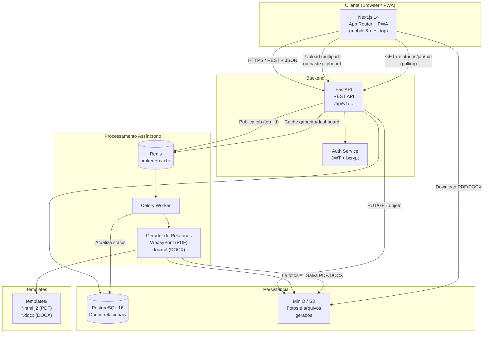
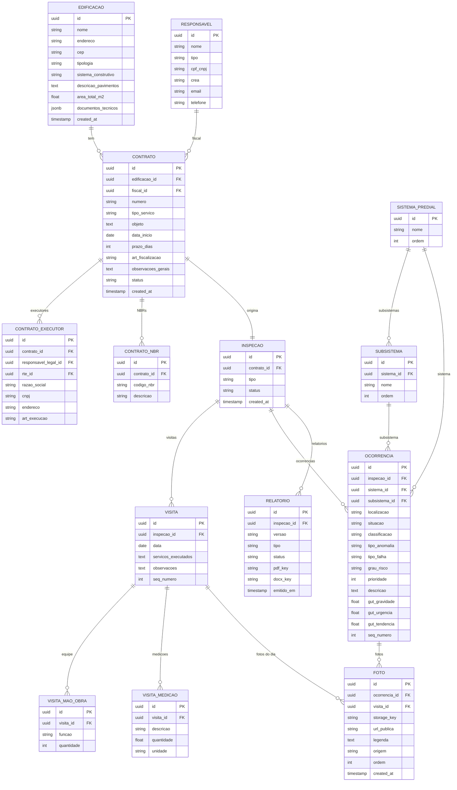
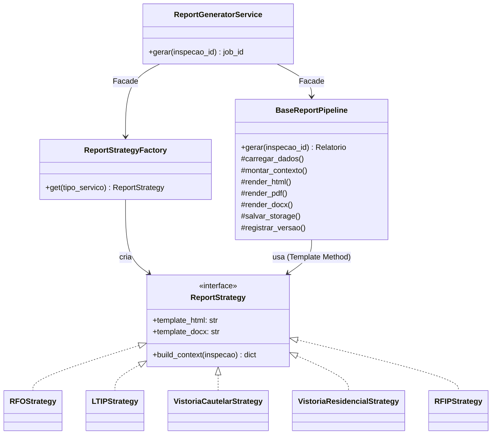
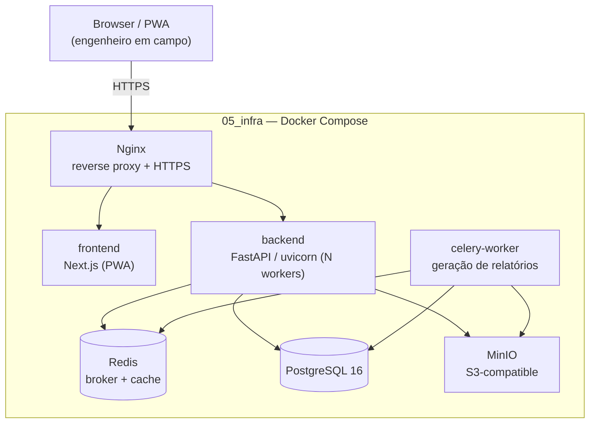
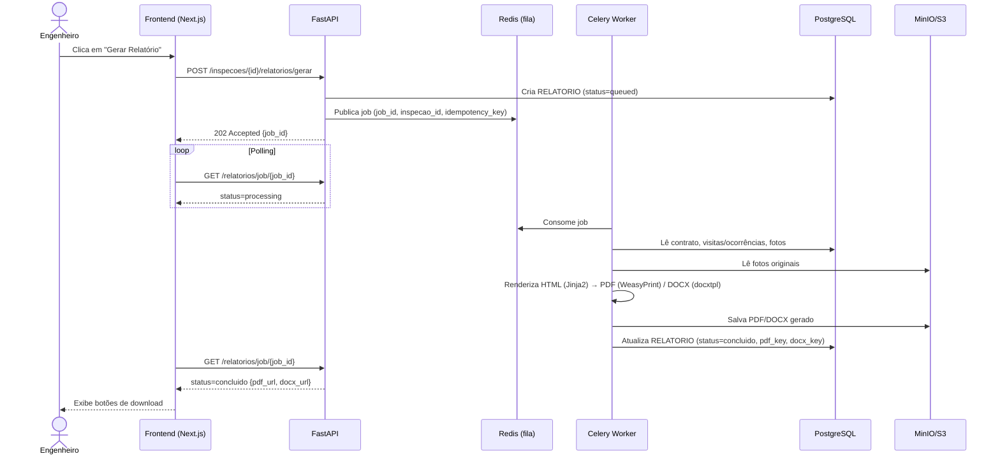
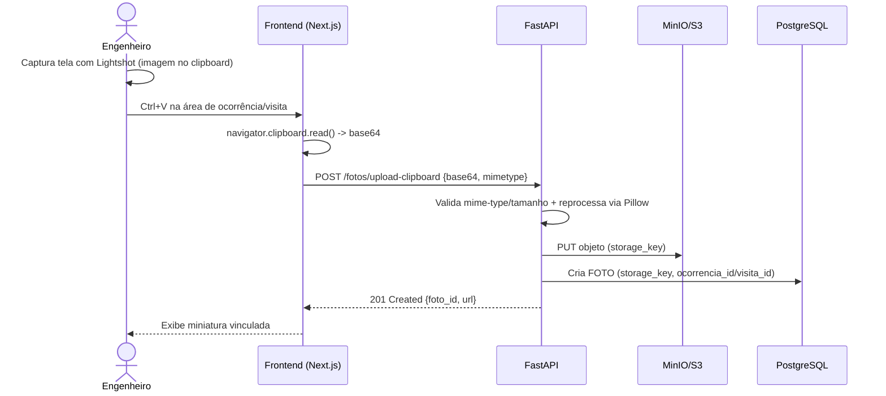
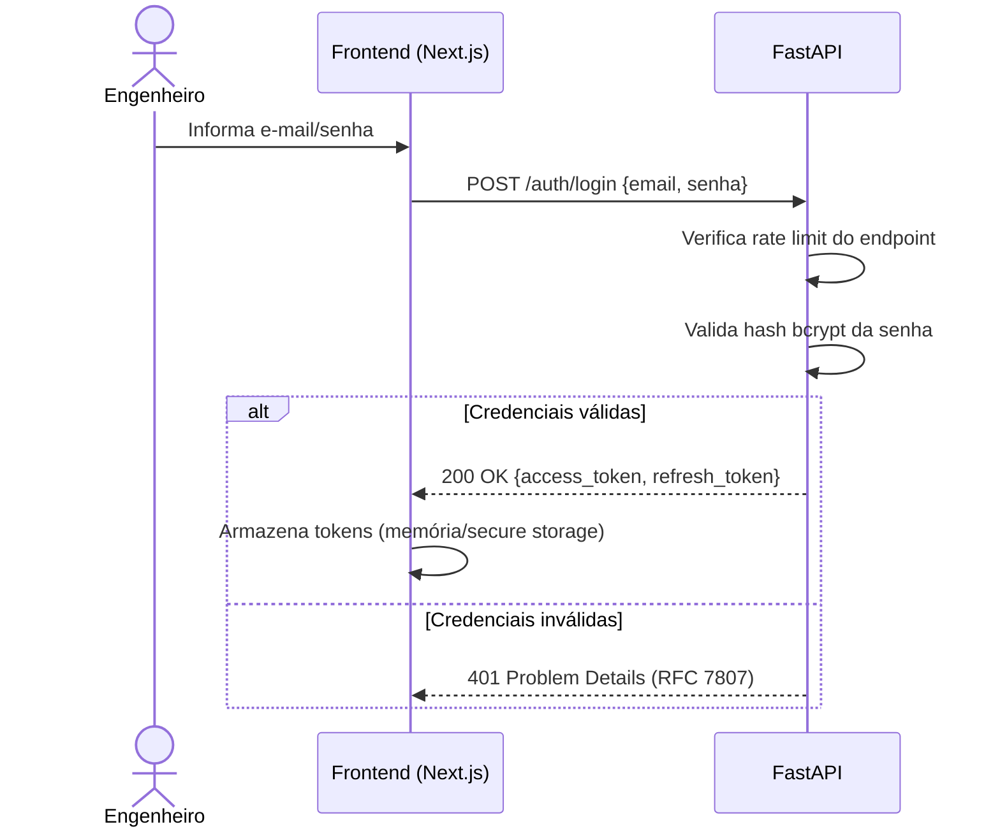

---
title: Arquitetura de Software — Sistema de Automação de Relatórios Prediais
type: knowledge
status: draft
owner: Garra Engenharia
related:
  - 00_docs/estudo-do-contexto.md
  - 00_docs/convertidos/RFO_INSPECAO.md
  - 00_docs/projeto/decisoes.md
tags: [arquitetura, stack, modelo-de-dados, api, pdf, lightshot, padroes-de-projeto, system-design, seguranca]
last_updated: 2026-07-17
---

<!-- ai-summary
System: blueprint técnico do sistema de automação de relatórios prediais da Garra Engenharia.
Flow: Next.js (PWA) -> FastAPI -> PostgreSQL + MinIO -> fila Redis/Celery -> gerador de PDF/DOCX (WeasyPrint + docxtpl).
Owner: Eng. Civil Esp. Roniel Ribeiro Costa.
Systems: Next.js, FastAPI, PostgreSQL, MinIO, Redis, Celery, WeasyPrint, docxtpl, Lightshot.
Status: draft — sujeito a validação das lacunas [A ESCLARECER] listadas em estudo-do-contexto.md. Seções 9-11 (padrões de projeto, system design, RNF) adicionadas em 2026-07-17.
-->

# Arquitetura de Software — Sistema de Automação de Relatórios Prediais

## 1. Stack Tecnológica

### Escolhas e justificativas

| Camada | Tecnologia | Justificativa |
|---|---|---|
| **Frontend** | Next.js 14 (App Router) como PWA | Funciona como site e app instalável no celular sem loja de app; renderização híbrida; excelente ecossistema de formulários e tabelas. |
| **Estilo / UI** | Tailwind CSS + shadcn/ui | Componentes acessíveis prontos (formulários, tabelas, modais); produtividade alta para interface de dados. |
| **Backend** | FastAPI (Python 3.12) | Mesmo ecossistema das bibliotecas de geração de PDF/DOCX (WeasyPrint, docxtpl, Jinja2, Pillow); async nativo; tipagem com Pydantic; documentação OpenAPI automática. |
| **Banco de dados** | PostgreSQL 16 | Modelo relacional forte para as entidades complexas (Ocorrência → Foto → Sistema → Subsistema); suporte a JSONB para campos flexíveis; transações ACID. |
| **ORM** | SQLAlchemy 2 + Alembic | ORM maduro com suporte async; migrations versionadas. |
| **Armazenamento de arquivos** | MinIO (auto-hospedado) ou AWS S3 | Fotos de inspeção podem chegar a GB por contrato; separar arquivos binários do banco é mandatório (RNF-07). API S3-compatível permite migrar entre provedores. |
| **Geração de PDF** | WeasyPrint + Jinja2 (HTML→PDF) | Permite construir templates HTML/CSS fiéis ao layout atual; suporte a imagens, tabelas complexas e paginação personalizada. Melhor controle de layout que ReportLab para documentos de alta fidelidade visual. |
| **Geração de DOCX** | docxtpl (python-docx + Jinja2) | Usa um arquivo .docx como template com tags `{{ variavel }}`; preserva a formatação exata do documento original. |
| **Autenticação** | FastAPI + JWT (python-jose) + bcrypt | Simples e seguro para uso individual/pequena equipe; sem dependência de serviço externo. |
| **Fila / Cache** | Redis 7 | Broker de tarefas assíncronas (Celery) e cache de curto prazo para gabarito de sistemas prediais e agregados do dashboard (ver ADR-06 e Seção 10.4). |
| **Processamento assíncrono** | Celery (worker dedicado) | Geração de PDF/DOCX de até 200 páginas roda fora do ciclo de requisição HTTP, cumprindo RNF-06 sem bloquear a API (ver ADR-06). |
| **Integração Lightshot** | Upload via clipboard paste (browser API) + upload manual | Ver seção 6. |
| **Deploy (sugestão)** | Docker Compose (local) ou Railway/Render (nuvem) | [A ESCLARECER] preferência de hospedagem. |

---

## 2. Diagrama de Arquitetura



---

## 3. Modelo de Dados (Diagrama ER)



---

## 4. Contratos de API

Base URL: `/api/v1`

### Edificações

| Método | Endpoint | Descrição |
|---|---|---|
| `GET` | `/edificacoes` | Lista edificações (paginado, filtro por nome/endereço) |
| `POST` | `/edificacoes` | Cria edificação |
| `GET` | `/edificacoes/{id}` | Detalhe da edificação com histórico de contratos |
| `PUT` | `/edificacoes/{id}` | Atualiza edificação |
| `GET` | `/edificacoes/{id}/dashboard` | Indicadores de saúde por sistema predial |

### Contratos

| Método | Endpoint | Descrição |
|---|---|---|
| `GET` | `/contratos` | Lista contratos (filtro por tipo, status, edificação) |
| `POST` | `/contratos` | Cria contrato com empresas executoras e NBRs |
| `GET` | `/contratos/{id}` | Detalhe completo do contrato |
| `PUT` | `/contratos/{id}` | Atualiza contrato |

### Inspeções e Visitas

| Método | Endpoint | Descrição |
|---|---|---|
| `GET` | `/inspecoes/{id}` | Detalhe da inspeção com visitas e ocorrências |
| `POST` | `/inspecoes/{id}/visitas` | Cria visita de fiscalização |
| `PUT` | `/visitas/{id}` | Atualiza visita (equipe, serviços, medições) |
| `POST` | `/visitas/{id}/mao-obra` | Adiciona registro de mão de obra |
| `POST` | `/visitas/{id}/medicoes` | Adiciona medição |

### Ocorrências

| Método | Endpoint | Descrição |
|---|---|---|
| `GET` | `/inspecoes/{id}/ocorrencias` | Lista ocorrências da inspeção (filtro por sistema, grau de risco) |
| `POST` | `/inspecoes/{id}/ocorrencias` | Cria ocorrência com classificação completa |
| `PUT` | `/ocorrencias/{id}` | Atualiza ocorrência |
| `DELETE` | `/ocorrencias/{id}` | Remove ocorrência |

### Fotos

| Método | Endpoint | Descrição |
|---|---|---|
| `POST` | `/fotos/upload` | Upload de arquivo (multipart/form-data) — retorna `storage_key` e URL |
| `POST` | `/fotos/upload-clipboard` | Recebe imagem em base64 do clipboard paste — retorna `storage_key` e URL |
| `POST` | `/ocorrencias/{id}/fotos` | Vincula foto a ocorrência com legenda |
| `POST` | `/visitas/{id}/fotos` | Vincula foto a visita de fiscalização |
| `PUT` | `/fotos/{id}` | Atualiza legenda ou ordem |
| `DELETE` | `/fotos/{id}` | Remove vínculo e objeto do storage |

### Relatórios

| Método | Endpoint | Descrição |
|---|---|---|
| `POST` | `/inspecoes/{id}/relatorios/gerar` | Dispara geração assíncrona de PDF e DOCX (retorna `job_id`) |
| `GET` | `/relatorios/job/{job_id}` | Consulta status do job de geração |
| `GET` | `/relatorios/{id}/download/pdf` | Download do PDF gerado |
| `GET` | `/relatorios/{id}/download/docx` | Download do DOCX gerado |
| `GET` | `/inspecoes/{id}/relatorios` | Histórico de versões emitidas |

### Dados Mestre

| Método | Endpoint | Descrição |
|---|---|---|
| `GET` | `/sistemas-prediais` | Lista sistemas com subsistemas |
| `GET` | `/gabarito/tipos-anomalia` | Lista tipos de anomalia |
| `GET` | `/gabarito/tipos-falha` | Lista tipos de falha |
| `GET` | `/gabarito/localizacoes` | Lista localizações padrão |
| `GET` | `/gabarito/funcoes-mao-obra` | Lista funções de mão de obra |

---

## 5. Estratégia de Geração de Relatório

### Princípio

O sistema usa **two-pass rendering**: primeiro gera um DOCX editável (para o engenheiro revisar e ajustar manualmente se necessário) e depois gera o PDF final — ou gera o PDF diretamente se o engenheiro optar por não revisar.

### Pipeline PDF (via WeasyPrint)

```
1. FastAPI recebe requisição POST /inspecoes/{id}/relatorios/gerar
2. Worker Celery (ver ADR-06) consulta banco: contrato, edificação,
   visitas/ocorrências com fotos, responsáveis
3. Jinja2 renderiza template HTML (.html.j2) com os dados
4. WeasyPrint converte HTML+CSS → PDF com:
   - Cabeçalho/rodapé em cada página (logo + dados do engenheiro + nº página)
   - Tabelas de ocorrências paginadas automaticamente
   - Fotos redimensionadas e organizadas por sistema predial
   - Sumário com âncoras automáticas
5. PDF salvo no MinIO; URL retornada ao frontend
```

### Pipeline DOCX (via docxtpl)

```
1. Mesmos dados do passo 2 acima
2. docxtpl abre o arquivo template .docx base (fiel ao modelo atual do cliente)
3. Substituição de tags {{ variavel }} e 
4. DOCX resultante salvo no MinIO; disponível para download e edição
```

### Templates

Os templates são arquivos versionados no repositório em `04_backend/templates/`:
- `rfo_template.html.j2` — Relatório de Fiscalização
- `ltip_template.html.j2` — Laudo de Inspeção Predial
- `vistoria_cautelar_template.html.j2` — Vistoria Cautelar
- `rfip_template.html.j2` — Relatório Fotográfico
- `rfo_template.docx` — equivalentes DOCX

---

## 6. Estratégia de Integração com Lightshot

O Lightshot não expõe API pública. As opções identificadas, em ordem de preferência:

### Opção A — Paste from Clipboard (Recomendada)

O engenheiro captura a tela com Lightshot, a imagem vai para o clipboard. Na interface web do sistema, ele clica em "Colar imagem" ou faz `Ctrl+V` em uma área de drop designada. O browser lê `navigator.clipboard.read()` e envia a imagem em base64 para o endpoint `POST /fotos/upload-clipboard`.

**Prós:** sem instalação adicional; funciona no fluxo atual do Lightshot.  
**Contras:** requer HTTPS (obrigatório para Clipboard API); usuário precisa estar na aba do sistema na hora do paste.

### Opção B — Upload Manual de Arquivo

O Lightshot tem opção de salvar como arquivo local. O engenheiro salva e depois faz upload via input de arquivo padrão. Interface suporta drag-and-drop e seleção múltipla.

**Prós:** funciona em qualquer contexto; mais simples de implementar.  
**Contras:** adiciona um passo manual (salvar + fazer upload).

### Opção C — Pasta Monitorada (Futuro)

[A ESCLARECER] Se o engenheiro salva fotos em uma pasta local específica, um cliente desktop leve poderia monitorar essa pasta e fazer upload automático. Escopo fora desta fase.

**Implementação recomendada:** disponibilizar ambas as Opções A e B na interface. Botão "Colar da área de transferência" (A) ao lado de botão "Enviar arquivo" (B), ambos vinculando a foto à ocorrência selecionada.

---

## 7. Estrutura de Pastas do Repositório

Convenção adotada: prefixo numérico de duas casas no diretório de topo, indicando a ordem lógica de leitura/consumo pelas equipes e agentes (docs → material de origem → protótipos → código → infraestrutura). `.github/` permanece sem prefixo por ser pasta de tooling com caminho fixo exigido pelo GitHub/VS Code.

```
garra-engenharia/
├── 00_docs/                       # documentação do projeto
│   ├── convertidos/               # documentos de referência convertidos (fonte: 01_output-context/)
│   ├── cliente/                   # documentos voltados ao cliente (proposta, apresentação)
│   ├── projeto/                   # gestão: escopo, backlog, cronograma, decisões, riscos, status
│   ├── estudo-do-contexto.md
│   └── arquitetura.md
│
├── 01_output-context/             # documentos originais do cliente (xlsm, pdf, docx, pbix) + .md convertidos
│
├── 02_prototipos/                  # wireframes HTML/CSS estático navegável (referência visual para o frontend)
│
├── 03_frontend/                    # Next.js 14 (PWA) — a implementar
│   ├── app/
│   │   ├── (auth)/                # login
│   │   ├── edificacoes/           # CRUD edificações
│   │   ├── contratos/             # CRUD contratos
│   │   ├── inspecoes/
│   │   │   └── [id]/
│   │   │       ├── visitas/       # RFO: visitas diárias
│   │   │       ├── ocorrencias/   # LTIP: ocorrências por sistema
│   │   │       └── relatorio/     # geração e download
│   │   └── dashboard/             # indicadores por edificação
│   ├── components/                # componentes reutilizáveis
│   └── public/                    # manifest.json, ícones PWA
│
├── 04_backend/                     # FastAPI — a implementar
│   ├── app/
│   │   ├── api/v1/                # routers (edificacoes, contratos, fotos, etc.) — camada fina, sem regra de negócio
│   │   ├── models/                # SQLAlchemy models (ORM)
│   │   ├── schemas/               # Pydantic schemas (DTOs de request/response, ver Seção 9.4)
│   │   ├── repositories/          # Repository Pattern: acesso a dados por agregado (Seção 9.2)
│   │   ├── services/              # Service Layer: regras de negócio (RN-01 a RN-13), transações
│   │   │   ├── report_generator/  # Facade + Strategy + Template Method (Seção 9.6-9.8)
│   │   │   │   └── strategies/    # rfo_strategy.py, ltip_strategy.py, vistoria_cautelar_strategy.py, ...
│   │   │   └── storage/           # Adapter para MinIO/S3 (Seção 9.9)
│   │   ├── workers/               # tasks Celery (geração de relatório, ver ADR-06)
│   │   ├── core/                  # config, auth, deps, exception handlers (Seção 10.7)
│   │   └── main.py
│   ├── templates/
│   │   ├── rfo_template.html.j2
│   │   ├── ltip_template.html.j2
│   │   ├── vistoria_cautelar_template.html.j2
│   │   ├── rfip_template.html.j2
│   │   ├── rfo_template.docx
│   │   └── assets/                # logo, CSS compartilhado
│   └── alembic/                   # migrations
│
├── 05_infra/                       # infraestrutura — a implementar (ver ADR-05)
│   ├── docker-compose.yml         # PostgreSQL + Redis + MinIO + backend + celery-worker + frontend (dev)
│   ├── docker-compose.prod.yml
│   ├── .env.example
│   ├── nginx/nginx.conf
│   └── backup/
│
└── .github/
    ├── agents/
    └── prompts/
```

---

## 8. ADRs (Architecture Decision Records)

### ADR-01 — Gerador de PDF: WeasyPrint + HTML/CSS

**Contexto:** o laudo de inspeção pode ter 200 páginas com tabelas complexas, cabeçalhos por página, fotos e sumário automático. A fidelidade ao template existente é mandatória (RNF-03).

**Alternativas consideradas:**
- **ReportLab**: programático, mas complexo para layouts ricos; difícil manter fidelidade visual sem code extenso.
- **Puppeteer/Playwright (HTML→PDF via Chrome)**: excelente qualidade mas requer runtime Node.js + Chrome no servidor; pesado.
- **WeasyPrint**: HTML+CSS→PDF em Python puro; suporte CSS completo; integra nativamente no backend FastAPI; menor overhead de infraestrutura.

**Decisão:** WeasyPrint para geração de PDF. Templates em HTML/CSS geridos pela equipe como arquivos no repositório. CSS page margins e `@page` rules controlam cabeçalho/rodapé.

**Consequências:** necessário validar que o layout HTML produz resultado visualmente idêntico ao template Word atual antes de ir para produção. Limitação: documentos muito complexos podem ter diferenças sutis de tipografia comparado ao Word.

---

### ADR-02 — Armazenamento de Imagens: MinIO (auto-hospedado) com API S3

**Contexto:** relatórios de inspeção podem acumular 500+ fotos por contrato. Armazenar blobs no PostgreSQL degradaria performance e aumentaria custo de backup (RNF-07).

**Alternativas consideradas:**
- **Sistema de arquivos local (disco)**: simples, mas não escala; difícil de fazer backup; sem URL pública.
- **AWS S3**: confiável, mas gera custo recorrente mesmo para volume pequeno; requer conta AWS.
- **MinIO**: self-hosted, API S3-compatível, sem custo de serviço; pode migrar para AWS S3 trocando apenas variáveis de ambiente.

**Decisão:** MinIO em Docker para ambiente local/desenvolvimento; configuração S3 real opcional para produção em nuvem. Todas as referências no código usam a SDK `boto3` (S3-compatível) para garantir portabilidade.

**Consequências:** necessidade de gerenciar backup do volume MinIO. Definir política de URL pré-assinada com expiração para URLs públicas de download.

---

### ADR-03 — Mobile: PWA em vez de App Nativo

**Contexto:** o engenheiro usa o sistema em campo com smartphone para registrar ocorrências e fotos (RNF-01). Desenvolver apps nativos (iOS + Android) seria custo e prazo muito maiores do que o necessário para um usuário individual.

**Alternativas consideradas:**
- **App nativo iOS/Android (React Native/Flutter)**: melhor experiência nativa, acesso a câmera e GPS; mas requer publicação em lojas, manutenção separada e custo de desenvolvimento 3x maior.
- **PWA (Progressive Web App)**: instalável na home screen, funciona offline (com Service Worker), acesso à câmera via `getUserMedia`, paste de clipboard; entregue como parte do Next.js sem infraestrutura adicional.

**Decisão:** PWA com Next.js. Manifest configurado para `display: standalone`. Cache de dados críticos (gabarito de sistemas, contratos em andamento) via Service Worker para uso parcialmente offline.

**Consequências:** [A ESCLARECER] confirmar se o offline completo é necessário. Acesso à câmera via PWA funciona em HTTPS; a captura via Lightshot (clipboard paste) também requer HTTPS.

---

### ADR-04 — DOCX via docxtpl em vez de geração programática

**Contexto:** o engenheiro precisa de um DOCX que seja editável antes da entrega final (RNF-04). O modelo Word atual usa formatação específica que é difícil de replicar programaticamente.

**Decisão:** usar o arquivo Word real do cliente como template, inserindo tags Jinja2 (`{{ }}` e ``) diretamente. O `docxtpl` processa o template mantendo toda a formatação original.

**Consequências:** o arquivo `.docx` de template vira um artefato versionado no repositório. Qualquer atualização no layout do modelo precisa ser feita no arquivo template Word + re-teste de geração.

---

### ADR-05 — Estrutura de pastas de topo: prefixo numérico, sem aninhamento `src/`

**Contexto:** documentos de planejamento anteriores (`.github/agents/devops.agent.md`, `.github/prompts/12-devops.prompt.md`) descreviam uma estrutura alternativa com `src/backend/`, `src/frontend/` e `infra/` (sem prefixo), divergente da estrutura de topo com prefixo numérico (`00_docs/`, `01_output-context/`, `02_prototipos/`) já adotada no restante do repositório. Havia ainda divergência sobre onde o `docker-compose.yml` deveria residir (raiz do repositório vs. `infra/`).

**Alternativas consideradas:**
- Manter `src/backend/` e `src/frontend/`: introduz um nível de aninhamento extra sem benefício claro para um projeto com apenas duas aplicações (backend e frontend); quebra a consistência com o prefixo numérico já usado nas demais pastas.
- `docker-compose.yml` na raiz do repositório: mistura artefatos de orquestração com pastas de código/documentação de topo; dificulta identificar de forma consistente onde está cada camada.
- `docker-compose.yml` em `infra/` sem prefixo: reintroduz a mesma inconsistência de nomenclatura que motivou a renumeração das demais pastas.

**Decisão:** eliminar o aninhamento `src/`. Backend em `04_backend/`, frontend em `03_frontend/`, infraestrutura em `05_infra/` — todos na raiz do repositório, seguindo o mesmo prefixo numérico das demais pastas. `docker-compose.yml`, `docker-compose.prod.yml` e `.env.example` residem em `05_infra/`; o build context dos serviços aponta para `../04_backend` e `../03_frontend`. Comandos Docker e scripts operacionais devem ser executados a partir de `05_infra/` (`cd 05_infra && docker compose up -d`). Comandos `npm`/`npx` do frontend são executados a partir de `03_frontend/`; comandos Python/uvicorn/alembic do backend a partir de `04_backend/`.

**Justificativa:** consistência total de convenção em todo o repositório — qualquer agente ou desenvolvedor sabe, pela numeração, a ordem de leitura e a localização de cada camada, sem exceções. Elimina ambiguidade sobre onde rodar comandos de terminal (`docker compose`, `npm`, `alembic`, etc.).

**Consequências:** todos os prompts de scaffold (`14` a `19`) e o agente/prompt de DevOps (`devops.agent.md`, `12-devops.prompt.md`) foram atualizados para referenciar `04_backend/`, `03_frontend/` e `05_infra/`. Qualquer nova automação deve seguir esta convenção; não criar `backend/`, `frontend/`, `infra/` ou `src/` soltos na raiz.

**Referência** | `00_docs/projeto/decisoes.md` DEC-09

---

### ADR-06 — Processamento Assíncrono: Celery + Redis

**Contexto:** a geração de relatórios (RFO/LTIP com até 200 páginas e 150+ fotos) não pode rodar dentro do ciclo de requisição HTTP sem violar RNF-06 (< 60s) e sem bloquear o worker do FastAPI para outros usuários. R-03 já identificava esse risco.

**Alternativas consideradas:**
- **FastAPI `BackgroundTasks`**: simples, sem infraestrutura extra, mas roda no mesmo processo da API (compete por CPU com requisições HTTP), não sobrevive a reinício do processo e não oferece retry/backoff nativo.
- **Celery + RabbitMQ**: robusto, mas RabbitMQ adiciona complexidade operacional desnecessária para o volume esperado (uso individual/pequena equipe).
- **Celery + Redis**: broker leve, já útil como cache (Seção 10.4), suporta retry/backoff, filas nomeadas e resultado de tarefas.

**Decisão:** Celery com Redis como broker e result backend. Endpoint `POST /inspecoes/{id}/relatorios/gerar` publica uma tarefa e retorna `202 Accepted` com `job_id`; o frontend consulta `GET /relatorios/job/{job_id}` por polling (padrão Async Request-Reply, Seção 9.12). Cada job usa uma **idempotency key** (`hash(inspecao_id + versao_alvo)`) para evitar geração duplicada em caso de retry ou duplo clique.

**Consequências:** exige um serviço `redis` e um serviço `celery-worker` adicionais no `docker-compose.yml` (`05_infra/`). Necessário monitorar filas presas (dead-letter) e definir política de retry (3 tentativas, backoff exponencial) — ver Seção 10.2.

**Referência** | `00_docs/projeto/decisoes.md` DEC-10

---

### ADR-07 — Padrão de Erros de API: RFC 7807 Problem Details

**Contexto:** com múltiplos tipos de documento e regras de validação por tipo de serviço (RN-05, RN-08), a API precisa de um formato de erro consistente e legível tanto por humanos (mensagens de validação em formulários) quanto por outros sistemas.

**Alternativas consideradas:**
- Formato de erro ad-hoc por endpoint (`{"error": "..."}`) — inconsistente, dificulta tratamento genérico no frontend.
- Apenas os erros padrão do FastAPI/Pydantic (`detail`) — insuficiente para diferenciar erros de negócio (ex.: "ocorrência sem foto") de erros de validação de schema.

**Decisão:** adotar `application/problem+json` (RFC 7807) em todas as respostas de erro 4xx/5xx, com campos `type`, `title`, `status`, `detail`, `instance` e um campo estendido `errors` para violações de campo a campo. Um exception handler global (`app/core/exception_handlers.py`) converte exceções de negócio (`DomainError`, `ValidationError`, `NotFoundError`) para esse formato.

**Consequências:** frontend implementa um único parser de erro para todos os formulários. Detalhado na Seção 10.7.

**Referência** | `00_docs/projeto/decisoes.md` DEC-11

---

### ADR-08 — Observabilidade Mínima v1: Logging Estruturado + Healthcheck

**Contexto:** equipe pequena, sem orçamento definido para APM completo (Sentry/Datadog/Prometheus). Ainda assim, é necessário rastrear falhas de geração de relatório (job assíncrono) e problemas de autenticação em produção.

**Alternativas consideradas:**
- **Sem logging estruturado** (apenas `print`/logs default) — inviável para depurar falhas assíncronas em produção.
- **Stack completa (Prometheus + Grafana + Sentry)** desde o v1 — overhead operacional desproporcional ao porte do projeto nesta fase.

**Decisão:** logging estruturado em JSON (biblioteca `structlog` ou `logging` + formatter JSON) correlacionando `request_id` (API) e `job_id` (worker), mais endpoints `/health` (liveness) e `/health/ready` (dependências: DB, Redis, MinIO). Integração com Sentry/Prometheus fica como evolução futura (pós v1.0), não bloqueando o lançamento.

**Consequências:** logs ficam no stdout dos containers (Docker Compose) na v1; sem retenção/alerting automatizado até que uma solução de APM seja contratada. Ver Seção 10.3.

**Referência** | `00_docs/projeto/decisoes.md` DEC-12

---

## 9. Padrões de Projeto (Design Patterns)

O backend segue uma **arquitetura em camadas** (layered architecture) que isola regra de negócio, acesso a dados e infraestrutura. A tabela resume os padrões adotados; os mais relevantes para o domínio (geração de relatórios) são detalhados em seguida.

| # | Padrão | Onde é aplicado | Problema que resolve |
|---|---|---|---|
| 9.1 | **Layered Architecture** | `api/` → `services/` → `repositories/` → `models/` | Separação de responsabilidades; troca de camada inferior (ex.: ORM) sem afetar regra de negócio. |
| 9.2 | **Repository Pattern** | `app/repositories/*_repository.py` (um por agregado: Edificação, Contrato, Inspeção, Ocorrência, Relatório) | Isola queries SQLAlchemy da camada de serviço; facilita testes com repositórios fake. |
| 9.3 | **Service Layer / Use Case** | `app/services/*_service.py` | Concentra as regras de negócio RN-01 a RN-13 e a demarcação de transação; endpoints ficam finos (thin controllers). |
| 9.4 | **DTO via Pydantic Schemas** | `app/schemas/` distinto de `app/models/` | Desacopla o contrato público da API (versionável em `/api/v1`) do schema interno do banco. |
| 9.5 | **Dependency Injection** | `Depends()` do FastAPI (sessão de DB, usuário autenticado, repositórios, serviços) | Inversão de controle; troca de implementação (ex.: storage fake em teste) sem alterar o código do endpoint. |
| 9.6 | **Strategy Pattern** | `ReportStrategy` com uma implementação por tipo de documento (RFO, LTIP, Vistoria Cautelar, Vistoria Residencial, RFIP) | Cada tipo de relatório tem contexto e templates próprios; novo tipo de documento não exige alterar o pipeline existente (Open/Closed). |
| 9.7 | **Factory Method** | `ReportStrategyFactory.get(tipo_servico)` | Seleciona a `ReportStrategy` correta a partir de `Contrato.tipo_servico`, sem `if/elif` espalhado pelo código. |
| 9.8 | **Template Method** | `BaseReportPipeline` (esqueleto fixo: carregar dados → montar contexto → render HTML → render PDF/DOCX → salvar → registrar versão) | Garante que toda geração de relatório siga a mesma sequência auditável (RN-07, RN-08, RF-11), variando apenas os passos específicos de cada Strategy. |
| 9.9 | **Adapter Pattern** | `StorageClient` (interface) + `S3StorageClient` (boto3/MinIO) | Troca de provedor de armazenamento (MinIO → AWS S3 → R2, ver ADR-02) sem alterar os serviços consumidores. |
| 9.10 | **Facade** | `ReportGeneratorService.gerar(inspecao_id)` | Ponto único de entrada que esconde a composição de Strategy + Template Method + Storage + persistência de versão. |
| 9.11 | **Unit of Work (implícito)** | Sessão/transação do SQLAlchemy por requisição ou por job | Garante atomicidade de operações compostas (ex.: criar Ocorrência + vincular Fotos) — commit único ao final do caso de uso. |
| 9.12 | **Async Request-Reply (Job Pattern)** | `POST /relatorios/gerar` (dispara job) + `GET /relatorios/job/{job_id}` (polling) sobre Celery/Redis (ADR-06) | Desacopla a requisição HTTP do processamento pesado, respeitando RNF-06. |
| 9.13 | **CQRS leve** | Queries de leitura do dashboard (RF-07) separadas do modelo transacional de escrita, com cache curto (Seção 10.4) | Evita que agregações pesadas de leitura concorram com o fluxo de escrita de ocorrências/visitas. |
| 9.14 | **Value Objects / Enums** | `GrauRisco`, `Situacao`, `Classificacao`, `TipoServico`, `StatusRelatorio` como Enums Pydantic | Elimina strings mágicas; apoia as regras RN-04 e RN-05 com valores fechados e validados. |
| 9.15 | **Idempotency Key** | Job de geração de relatório usa `hash(inspecao_id + versao_alvo)` como chave | Evita relatórios duplicados em caso de retry do worker ou duplo clique do usuário (ver ADR-06). |

### Diagrama — Strategy + Factory + Template Method (geração de relatório)



---

## 10. System Design — Segurança, Assincronia e Operação

### 10.1 Segurança (mapeamento OWASP Top 10:2021)

| Categoria OWASP | Risco no contexto do sistema | Mitigação arquitetural |
|---|---|---|
| **A01 — Broken Access Control** | Usuário acessar/editar contratos ou relatórios de outro engenheiro (cenário multi-usuário, lacuna #2) | Toda query de leitura/escrita filtrada por proprietário no repository layer; checagem de posse antes de update/delete; IDs em UUID (não sequenciais/adivinháveis). |
| **A02 — Cryptographic Failures** | Exposição de CPF/CNPJ, endereços e fotos de imóveis (dados sensíveis) | HTTPS obrigatório em todos os ambientes (também exigido pela Clipboard API); senhas com bcrypt; segredos via variáveis de ambiente fora do repositório (`.env`, nunca commitado); URLs de download do MinIO pré-assinadas com expiração curta. |
| **A03 — Injection** | Filtros dinâmicos em listagens (`/contratos`, `/edificacoes`) e dashboard | SQLAlchemy ORM com bind parameters em 100% das queries; nenhuma concatenação de SQL; validação de entrada via Pydantic antes de qualquer acesso ao banco. |
| **A04 — Insecure Design** | Emissão de relatório inconsistente ou duplicado | RN-08 (bloqueia emissão sem campos obrigatórios); idempotency key no job de geração (ADR-06); versionamento explícito e imutável de relatórios emitidos (RF-11). |
| **A05 — Security Misconfiguration** | CORS aberto, documentação interativa exposta em produção | CORS restrito ao(s) domínio(s) do frontend; `/docs` e `/redoc` desabilitados fora de `ENV=development`; configuração via variáveis de ambiente com defaults seguros (fail-closed). |
| **A06 — Vulnerable and Outdated Components** | Dependências Python/Node desatualizadas (WeasyPrint, docxtpl, Pillow, Next.js) | Lockfiles versionados (`requirements.txt`/`poetry.lock`, `package-lock.json`); revisão periódica de dependências (backlog BL-23). |
| **A07 — Identification and Authentication Failures** | Força bruta em login; token sem expiração | JWT de curta duração + refresh token; rate limiting no endpoint de login; bcrypt com custo adequado; bloqueio temporário após N tentativas falhas. |
| **A08 — Software and Data Integrity Failures** | Upload de foto manipulada ou arquivo malicioso disfarçado de imagem (clipboard ou arquivo) | Validação de mime-type real (magic bytes) e tamanho máximo; reprocessamento via Pillow (recodifica a imagem, removendo metadados/EXIF e payloads embutidos) antes de persistir no storage. |
| **A09 — Security Logging and Monitoring Failures** | Falta de rastreabilidade sobre quem criou/alterou Ocorrência ou Relatório | Logging estruturado com `request_id`/`user_id`/`job_id` (ADR-08); campos de auditoria (`created_at`, `updated_at`, autor) nas entidades sensíveis. |
| **A10 — Server-Side Request Forgery** | Endpoint de upload aceitar URL fornecida pelo cliente | Uploads sempre via `multipart/form-data` ou base64 processados localmente; nenhum endpoint busca conteúdo de URL externa fornecida pelo usuário. |

### 10.2 Processamento Assíncrono e Idempotência

- Todo job de geração de relatório tem um `job_id` (UUID) e um estado: `queued` → `processing` → `concluido` | `falhou`.
- **Idempotency key** = `hash(inspecao_id + versao_alvo)`: se o mesmo job for republicado (retry automático ou duplo clique do usuário), o worker detecta o resultado já existente e não reprocessa.
- **Política de retry**: até 3 tentativas com backoff exponencial (ex.: 5s, 30s, 120s); após esgotar as tentativas, o `RELATORIO` é marcado `falhou` com mensagem de erro persistida e exibida ao usuário.
- **Timeout de job**: geração deve concluir em até 60s (RNF-06); jobs além desse limite são instrumentados via log de alerta para investigação de performance (compressão de imagem, paginação do WeasyPrint).

### 10.3 Observabilidade

- Logging estruturado em JSON, correlacionando `request_id` (por requisição HTTP) e `job_id` (por tarefa Celery), permitindo reconstruir o fluxo completo de uma geração de relatório entre API e worker.
- Endpoints `GET /health` (liveness) e `GET /health/ready` (checa conectividade com PostgreSQL, Redis e MinIO) para uso em orquestração (Docker healthcheck / futura migração para Kubernetes).
- APM completo (Sentry para erros, Prometheus/Grafana para métricas) fica fora do escopo da v1.0 (ADR-08), mas a estrutura de logging já é compatível com adoção futura sem retrabalho.

### 10.4 Estratégia de Cache

- **Gabarito de sistemas prediais/subsistemas/tipos de anomalia** (RF-10): dado quase estático — cache em Redis com TTL longo (ex.: 1h) ou invalidação manual ao editar o gabarito.
- **Agregados do dashboard** (RF-07): cache curto (ex.: 60s) por edificação, evitando recomputar contagens/proporções a cada carregamento de tela; invalidado ao criar/editar Ocorrência daquela edificação.

### 10.5 Topologia de Deploy



### 10.6 Diagramas de Sequência dos Fluxos Críticos

**(a) Geração assíncrona de relatório (polling)**



**(b) Upload de foto via Lightshot (clipboard paste)**



**(c) Autenticação (login)**



### 10.7 Tratamento de Erros e Contrato de Erro da API

Todas as respostas de erro seguem RFC 7807 (`application/problem+json`, ver ADR-07):

```json
{
  "type": "https://garra-engenharia/erros/ocorrencia-sem-foto",
  "title": "Ocorrência não conforme sem foto vinculada",
  "status": 422,
  "detail": "A ocorrência 'Infiltração na platibanda' é Não Conforme e exige ao menos 1 foto antes da emissão do relatório (RN-03, RN-08).",
  "instance": "/api/v1/ocorrencias/8f3e...",
  "errors": [
    { "field": "fotos", "message": "Pelo menos uma foto é obrigatória." }
  ]
}
```

Um exception handler global em `app/core/exception_handlers.py` converte três famílias de exceção para esse formato: `ValidationError` (Pydantic, 422), `DomainError` (violação de regra de negócio, 422/409) e `NotFoundError` (404). Erros 5xx não expõem stack trace ao cliente — apenas um `title` genérico e o `request_id` para correlação com os logs (Seção 10.3).

### 10.8 Estratégia de Offline (posição provisória)

Conforme `00_docs/projeto/escopo.md` (fora de escopo da v1.0) e a lacuna #3 de `estudo-do-contexto.md` (RNF-02), o suporte offline completo (Service Worker + IndexedDB + fila de sincronização) **não está incluído na v1.0**. Posição arquitetural interina:

- O Service Worker da PWA (ADR-03) cacheia apenas dados de **leitura** de baixa volatilidade: gabarito de sistemas prediais, lista de contratos em andamento.
- Operações de **escrita** (criar visita, ocorrência, foto) exigem conectividade — falha de rede resulta em erro explícito ao usuário, sem fila local.
- Caso a sessão de validação com o cliente (BL-18, risco R-07) confirme a necessidade de offline completo, isso deve ser tratado como incremento arquitetural dedicado (fila local IndexedDB + sincronização com resolução de conflito), não incorporado retroativamente sem replanejamento de escopo/cronograma.

---

## 11. Requisitos Não Funcionais Atendidos

| RNF | Requisito | Como a arquitetura atende | Seção |
|---|---|---|---|
| **RNF-01** | Usabilidade mobile em campo (PWA, sem app nativo) | Next.js 14 PWA, `manifest.json` `display: standalone`, componentes shadcn/ui responsivos | ADR-03, Seção 1 |
| **RNF-02** | Operação offline | Cache de leitura via Service Worker; escrita offline completa fica fora da v1.0 (posição interina) | Seção 10.8 |
| **RNF-03** | Fidelidade ao template | WeasyPrint + Jinja2 (PDF) e docxtpl (DOCX) usando o arquivo original do cliente como template | ADR-01, ADR-04, Seção 5 |
| **RNF-04** | Exportação PDF e DOCX | Pipeline dual (Template Method) gera ambos os formatos a partir do mesmo contexto de dados | Seção 5, Seção 9.8 |
| **RNF-05** | Autenticação | JWT + bcrypt, rate limiting em `/auth/login`, refresh token | Seção 1, Seção 10.1 (A07) |
| **RNF-06** | Performance de geração (< 60s, 200 págs., 150+ fotos) | Processamento assíncrono via Celery/Redis fora do ciclo HTTP; compressão de imagens antes da renderização | ADR-06, Seção 10.2 |
| **RNF-07** | Armazenamento de imagens fora do banco relacional | MinIO/S3 via Adapter (`StorageClient`), URLs pré-assinadas com expiração | ADR-02, Seção 9.9 |
| **RNF-08** | Backup e versionamento de dados | Backup do volume PostgreSQL/MinIO via scripts em `05_infra/backup/`; versionamento de relatórios emitidos (RF-11) | Seção 7; [A ESCLARECER] frequência de backup |


